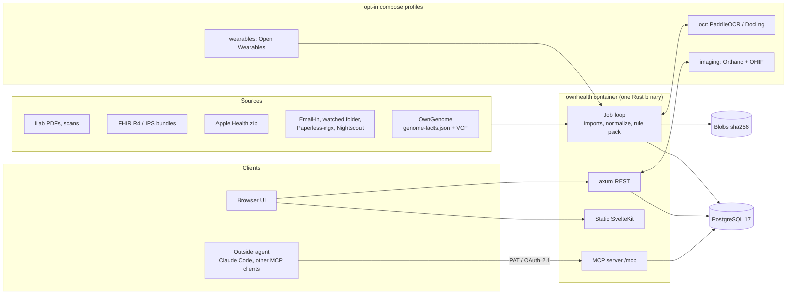

# OwnHealth plan

Status: planning. No code yet. This file is the entry point; the [doc map](#doc-map) at the end links to the detail, and the [glossary](#glossary) expands every acronym.

## The problem

Health data is scattered. A typical adult has:

- lab PDFs from three or four labs, some in Spanish, some in English, each with its own names, units and reference ranges;
- records in more than one health system, because people move between countries, between public and private care, or between insurers;
- a phone and a watch writing to Apple Health, Health Connect, Garmin, Oura or Whoop;
- maybe a genome: a consumer chip, or a whole-genome sequence (WGS) with findings nobody connects to the prescriptions;
- imaging on CDs and DICOM downloads that nobody can open twice.

No self-hosted project joins these. The ones that exist cover one slice: US portal sync, a wearable, a VCF, a FHIR server. The one serious rival with lab standardization (Mirobody) wraps it in an embedded chat agent and treats the genome as 12 pharmacogenes.

Agents such as Claude Code are now good at reasoning over this data, but they cannot read it safely. Today the choices are pasting PDFs into a chat, or running a single-source MCP server with no provenance, no scopes and no record of what the agent read. Imported documents are untrusted text, and nobody treats them that way.

## What OwnHealth is

**The health data layer you own.** One store per household, with one profile per person, and two views of it:

1. **A web page:** health at a glance. Current state, flags, trends, sources, the review queue.
2. **An MCP server:** the main interface for an outside agent. Eight tools in v0.1, scoped tokens, a citation on every fact, an audit log of every read.

OwnHealth has no chat agent and no built-in LLM. The agent is whatever the person already uses. This matches the MCP 2026-07-28 spec, which deprecates Sampling (servers asking the client's model to generate).

License: AGPL-3.0-or-later. Repo: https://github.com/GeiserX/OwnHealth

## Who it is for

| Who | What they need from us |
|---|---|
| Self-hosters | One `docker compose up`, Postgres, backups that restore, no vendor cloud |
| Families | One login managing several profiles: a child, a parent who never signs in, a partner |
| Quantified-self people | Wearable history kept forever, joined with labs, trends with coverage |
| People with a WGS | Genome findings joined with medications and labs, with evidence levels. [OwnGenome](https://github.com/GeiserX/OwnGenome) turns the raw genome into those findings |
| People who move between health systems | PDFs and FHIR bundles from any country, Spanish and English from day one, SI and conventional units |

## Principles

1. **Provenance on every value.** Each value points to where it came from: a value read from a document points to the document, page and bounding box (only the page when a scan without a word layer gives no box, as with OCR off); an imported value points to its import (the FHIR resource, the Apple Health record, the genome facts file and finding); a typed-in value points to the person and time that entered it. The printed value, unit and range are the truth layer, and so is a code the source sent: a LOINC code or UCUM unit in an imported resource is kept through every re-derivation. LOINC code, UCUM unit and canonical value are otherwise derived and recomputable.
2. **Nothing silent.** Unconvertible units, rejected rows and low-confidence extractions go to a visible review queue. Nothing is dropped.
3. **Deterministic current state.** A versioned rule pack builds each person's status. Same data, same rules, same bytes, with a `state_hash`. Narrative text comes only from a human or an agent, labelled with its author.
4. **Agent-assisted extraction without an embedded agent.** The outside agent reads pending pages over MCP and calls `propose`. OwnHealth validates (LOINC exists, UCUM converts, plausible range, value grounded in the page's word layer) and queues for human confirmation.
5. **Imported text is untrusted.** Free text over MCP is marked `trust: untrusted_text`. Raw document text needs scope `read:documents_text`, off by default. No MCP tool can create an outbound share or export. Every agent write goes through the review queue. The email inbox accepts allowlisted senders only. Injection fixtures live in the test suite.
6. **Information, not diagnosis.** Intended purpose: personal record keeping and display of values from published formulas, with citations. Pharmacogenomics (PGx) output quotes the CPIC and DPWG guidelines and says "discuss with your prescriber", never "do not take X".
7. **Standards at the edges.** FHIR R4 (US Core, IPS, EU Patient Summary, HL7 Europe Lab) for import and export. Inside: our own Postgres tables, FHIR-shaped JSONB plus typed projection columns. No embedded Medplum or HAPI. openEHR and OMOP are out of scope.
8. **Build on, don't rebuild.** Open Wearables (MIT) sidecar for wearable OAuth. Orthanc + OHIF for imaging. Paperless-ngx as a document source. Nightscout for CGM. [OwnGenome](https://github.com/GeiserX/OwnGenome) for all genome compute, consumer chips included. OwnHealth only ingests.
9. **Simple to run.** One app container plus Postgres. Heavy parts are opt-in compose profiles.
10. **Dark theme by default.** Spanish and English from the first screen. SI and conventional units.

## What we beat and how

Legend: **yes**, **partial**, **no**. OwnHealth cells give the phase that delivers it. Rival cells reflect each project's README or source on 2026-11-07; details and sources are in [research/rivals.md](research/rivals.md).

| Capability | OwnHealth | Mirobody | Fasten On-Prem | Mere Medical | health-os | HealthWallet.me | Open Wearables | Apple Health / Google Health apps |
|---|---|---|---|---|---|---|---|---|
| Self-hosted | yes | yes | yes | yes | yes | partial (mobile, Fasten backend) | yes | no |
| Maintained | new | yes | no (archived; archive date unverified) | yes (pre-release, one maintainer) | yes (small) | yes | yes | yes |
| Lab PDF import, text layer + OCR | v0.1 / v0.2 | yes | no | no (unverified) | partial (model in client) | yes (on-device model) | no | no |
| Provenance to page and box | v0.1 | partial (file + page) | partial (FHIR source) | partial (FHIR source) | partial (unverified) | no (unverified) | no | no |
| Review queue, nothing dropped | v0.1 | no (silent unit drops, their own roadmap) | no | no | yes (pending until approved) | no | no | no |
| Non-US records (EU, Spain, IPS, any-language PDF) | v0.1 (PDF, IPS) | partial (CN/JA/EN labs) | no | no | no | partial (IPS export) | n/a | partial |
| US portal sync (SMART on FHIR) | v1.0 | no | no (removed Feb 2026) | yes | no | yes (via Fasten) | no | yes |
| FHIR R4 import and export | v0.1 import | partial (genomics export only) | yes | partial (import) | no (unverified) | yes | no | partial (Apple export zip) |
| Wearables | v0.1 Apple zip, v0.2 phone push, v1.0 OAuth | yes | no | no | no (unverified) | no | yes | yes |
| WGS-grade genome findings | v0.1 via OwnGenome | partial (489 sites, 12 PGx genes, phenotype `not_determined`) | no | no | no | no | no | no |
| Drug check: PGx + meds + labs | v0.1 (full medication lane v0.3) | partial (no star alleles) | no | no | no | no | no | no |
| Imaging (DICOM viewer) | v1.0 | no | no | no | no | no | no | no |
| Family profiles and roles | v0.1 | yes (care circles) | yes | no (unverified) | no (unverified) | no (unverified) | no (B2B users) | partial (sharing) |
| MCP server over all sources | v0.1 | yes | no | no | yes | no | partial (wearables only) | no |
| MCP auth: scoped tokens, OAuth 2.1, read audit | v0.1 PATs + audit, v0.2 OAuth | no (10-day link, hand-written JSON-RPC) | n/a | n/a | partial (unverified) | n/a | partial (API keys) | n/a |
| Works without an embedded LLM | yes (none shipped) | no (chat agent is the centre) | yes | yes | yes | no (on-device model for scans) | yes | partial (Google ships a Gemini coach) |
| License | AGPL-3.0-or-later | Apache-2.0 | GPL-3.0 | MIT | AGPL-3.0 | GPL-3.0 | MIT | proprietary |

What the table says:

- **Records outside the US** are empty ground. Every portal connector anyone ships targets US EHR vendors (Epic, Oracle Health, athena, eClinicalWorks, NextGen, VA and others); none targets a non-US portal.
- **Genome depth** is empty ground. Nobody joins WGS findings, carrier status, PGx star alleles and the prescription list.
- **Imaging** is empty ground for self-hosted PHRs.
- **Approve-before-commit** exists only in health-os. We take the pattern and add provenance and genome depth; the pattern alone is not our edge.
- **"Nobody does family PHRs" is wrong.** Mere Medical, health-os and smaller projects exist. None has traction, so the wedge holds.

What we take from rivals:

- Mirobody's LOINC/UCUM resolver bundle (Apache-2.0 overlays such as `resolver_overrides.tsv` and `recall_synonyms.tsv`, plus LOINC 2.83 content under the LOINC License and UCUM under the UCUM License), where the unit picks the code (total cholesterol in mmol/L is 14647-2, in mg/dL 2093-3). We add a multilingual alias table and keep the original spelling for resolution.
- Text layer first, OCR only for scanned pages, rule-read tables, content-hash cache (Mirobody).
- "Managed until claimed" profiles for a parent who never signs in (Mirobody).
- Pending-until-approved writes (health-os).
- Device-day authority, so steps from a watch and a phone are not counted twice (Mirobody).

## Scope

| In | Out (for now) | Never |
|---|---|---|
| Labs, vitals, conditions, medications, supplements, immunizations, documents | openEHR, OMOP CDM | A Strava API connector (its June 2026 policy bans AI and MCP use; bulk export import only) |
| Genome findings from OwnGenome, VCF lookups | Running genome engines in the app | An embedded chat agent or built-in LLM |
| PDF, FHIR R4, IPS, Apple Health zip, manual entry | Storing BAM/CRAM in OwnHealth | Shipped SNOMED CT or WHO ATC content |
| Wearables via Open Wearables, Nightscout, Gadgetbridge, Health Auto Export | Our own wearable OAuth apps | An MCP tool that shares or exports outward |
| Imaging via Orthanc + OHIF (opt-in) | Our own DICOM viewer | Diagnosis or treatment advice |
| Calculators with citations (v0.3) | Drug-drug interactions until an open-licence source exists | |
| Family roles, break-glass (v1.0) | Multi-household sync (moonshot) | |

## Architecture at a glance

One Rust binary (Python 3.13 up to 0.1.1): axum for the REST API, rmcp, the official Rust MCP SDK, at `/mcp` (streamable HTTP, spec 2026-07-28 with a 2025-11-25 fallback), an in-process job loop on a Postgres queue (`SELECT ... FOR UPDATE SKIP LOCKED`), and the SvelteKit UI built to static files and served by the same process. PostgreSQL 17. Blobs are content-addressed immutable files (`blobs/sha256/ab/cd/...`). No Redis, no TimescaleDB, no JVM in core.



Auth: passkeys by default, optional OIDC (Pocket ID, Authentik, Authelia). MCP: hashed scoped personal access tokens (PATs) in v0.1; OAuth 2.1 resource server (RFC 9728 metadata, RFC 8707 audience) with Client ID Metadata Documents (CIMD) in v0.2. Dynamic Client Registration only if a real client needs it; 2026-07-28 deprecates it.

Detail: [design/architecture.md](design/architecture.md), [design/ingestion.md](design/ingestion.md), [design/connectors.md](design/connectors.md).

## The MCP experience

The eight v0.1 tools: `get_health_status`, `search_observations`, `get_trend`, `get_genome_findings`, `lookup_variant`, `check_drug`, `get_source`, `propose`. `tools/list` is filtered by the token's scopes. Every fact carries a `src` id that `get_source` resolves to document, page and box. Responses are summary-first, around 4k tokens by default, 15k at most (under Claude Code's 25k `MAX_MCP_OUTPUT_TOKENS`). Full contract: [design/mcp.md](design/mcp.md).

Three exchanges with a synthetic person, Alex Rivera (`alex`). All three calls exist in v0.1. The values come from the synthetic fixture in [architecture.md section 16](design/architecture.md#16-testing-strategy).

### 1. "How is my health right now?"

The agent calls one tool and gets a compact, deterministic snapshot.

```
get_health_status(profile="alex")
```

```json
{
  "profile": "alex", "as_of": "2026-11-07",
  "rules_version": "ownhealth-rules 0.1.0", "state_hash": "sha256:4be1...",
  "flags": [
    {"rank": 1, "kind": "out_of_range", "analyte": "Lp(a)", "loinc": "LOINC:43583-4",
     "value": 142, "unit": "nmol/L", "ref": "<75", "flag": "H", "date": "2025-09-08",
     "text": "Lp(a) 142 nmol/L (H, lab range <75) on 2025-09-08.", "src": ["src_a07"]},
    {"rank": 2, "kind": "out_of_range", "analyte": "Vitamin D 25-OH", "loinc": "LOINC:62292-8",
     "value": 24, "unit": "ng/mL", "ref": "30-100", "flag": "L", "date": "2026-09-14",
     "text": "Vitamin D 24 ng/mL (L, lab range 30-100) on 2026-09-14.", "src": ["src_a12"]},
    {"rank": 3, "kind": "gene_drug", "gene": "SLCO1B1", "drug": "atorvastatin",
     "text": "Current statin has a CPIC actionable phenotype. Discuss with your prescriber.",
     "src": ["src_g31", "src_m02"]},
    {"rank": 4, "kind": "stale", "analyte": "TSH", "loinc": "LOINC:3016-3",
     "last": "2025-01-20", "window_months": 12, "src": ["src_a05"]}
  ],
  "never_measured": [{"analyte": "Hepatitis C antibody", "reason": "rule infect.hcv.once_adult"}],
  "medications": [{"name": "Atorvastatin 20 mg", "since": "2026-03-10", "src": ["src_m02"]},
                  {"name": "Omeprazole 20 mg", "since": "2026-04-01", "src": ["src_m05"]}],
  "priorities": {"author": "person", "updated": "2026-10-30",
                 "text": "Recheck vitamin D in winter.", "trust": "untrusted_text"},
  "freshness": {"labs": "2026-09-14", "wearables": "2026-11-06", "genome": "2026-10-02"},
  "limitations": ["Genome findings are research-grade unless a clinical lab confirmed them."]
}
```

### 2. "Can I take clopidogrel?"

```
check_drug(profile="alex", drug="clopidogrel")
```

Scopes: any of `read:genome`, `read:records`, `read:labs`; parts the token cannot see are listed as withheld. The answer quotes the guideline and the evidence; it does not decide.

```json
{
  "drug": "clopidogrel", "as_of": "2026-11-07",
  "pgx": [{"gene": "CYP2C19", "diplotype": "*1/*2", "phenotype": "intermediate metabolizer",
           "evidence": "E1", "confidence": "high", "call_state": "alt",
           "guidance": [
             {"source": "CPIC", "indication": "ACS/PCI", "strength": "Strong",
              "text": "Avoid standard dose (75 mg) clopidogrel if possible. Use prasugrel or ticagrelor at standard dose if no contraindication."},
             {"source": "CPIC", "indication": "neurovascular", "strength": "Moderate",
              "text": "<CPIC text, verbatim>"}],
           "url": "https://cpicpgx.org/guidelines/guideline-for-clopidogrel-and-cyp2c19/",
           "src": ["src_g07"]}],
  "current_medications": [{"name": "Omeprazole 20 mg", "since": "2026-04-01", "src": ["src_m05"]}],
  "phenoconversion": [{"gene": "CYP2C19", "by": "Omeprazole 20 mg",
                       "text": "Omeprazole is a CYP2C19 inhibitor. CPIC has no conversion rule for CYP2C19; effect not computed."}],
  "relevant_labs": [{"analyte": "Platelets", "value": 231, "unit": "10*9/L", "date": "2026-09-14", "src": ["src_a12"]}],
  "not_assessed": ["drug-drug interactions (no open-licence source configured)"],
  "advice": "Discuss with your prescriber.",
  "db_versions": {"cpic": "2026-09", "owngenome_facts": "ownhealth.genome-facts/v1"}
}
```

### 3. "Show my LDL trend over the last five years"

```
get_trend(profile="alex", code="LOINC:13457-7", window="P5Y")
```

```json
{
  "analyte": "LDL-C", "unit": "mg/dL", "resolution": "per_draw", "coverage_pct": 100,
  "points": [
    {"date": "2021-11-09", "value": 163, "src": "src_1a0"},
    {"date": "2022-09-15", "value": 96, "src": "src_2b4"},
    {"date": "2023-03-21", "value": 88, "src": "src_2c1"},
    {"date": "2023-10-04", "value": 92, "method": "direct", "src": "src_3c8"},
    {"date": "2024-05-22", "value": 84, "method": "direct", "src": "src_3d2"},
    {"date": "2025-01-20", "value": 79, "src": "src_a05"},
    {"date": "2025-09-08", "value": 101, "src": "src_a07"},
    {"date": "2026-03-02", "value": 118, "src": "src_9f3"},
    {"date": "2026-09-14", "value": 97, "src": "src_a12"}
  ],
  "trend": {"method": "Mann-Kendall", "significant": false},
  "notes": ["2023-10-04 and 2024-05-22 are direct LDL (LOINC 18262-6); the method change is marked.",
            "Atorvastatin started 2022-06-20, paused 2025-12-01, restarted 2026-03-10."]
}
```

When the agent wants to show the person where 97 came from, it calls `get_source("src_a12")` and gets the document id, page 2, the bounding box and a crop URL. Any free text in that answer is marked `trust: untrusted_text`.

## The deterministic current state

`current_state = render(rules_version, facts, as_of)`. Same inputs give byte-identical output and the same `state_hash`. No model runs.

- **Facts:** every observation, medication, condition, genome fact and document is an immutable row with `effective_at`, `recorded_at`, provenance class (clinical, consumer, device, self-reported, agent-written), status (`current`, `superseded`, `retracted`, `provisional`) and `supersedes`. A correction is a new row. The old one stays visible as withdrawn, with date and reason.
- **Rule pack:** versioned YAML, shipped default, overridable per install. Each rule cites its source.
- **Checks, in fixed order, each with a reason code:**
  1. recency window per analyte class (example: HbA1c 6 months, lipids 12 months); older is **stale**;
  2. relevant but **never measured** (by age, sex, conditions, meds, genome facts);
  3. outside the lab's own printed range (`H`, `L`, critical when the lab says so);
  4. significant change above the reference change value (RCV);
  5. trend: monotonic over 3 or more points;
  6. gene x drug: a current medication with a CPIC/DPWG actionable phenotype;
  7. gene x lab: a genotype paired with an analyte (example: LPA risk variant with Lp(a)).
- **Ranking:** severity x recency decay x actionability, ties broken by code. Stable order, no model.
- **Text:** templates per reason code, localised es/en.
- **Narrative:** a `priorities` block written by the person, or proposed by an agent through `propose(kind="note")` and confirmed. It renders verbatim with author and date. The deterministic part never depends on it.
- **Recompute** on every import or confirmed write; store each snapshot with its hash so changes over time are a diff of two snapshots.

## Risks and how we handle them

| Risk | What could happen | What we do |
|---|---|---|
| Prompt injection through imported documents | A lab PDF from the email inbox carries hidden text telling the agent to send the genome to a URL, or to write false values | Free text marked `trust: untrusted_text`; raw text behind `read:documents_text`, off by default; no MCP tool shares or exports; every agent write lands in the review queue, which shows what the agent read (from the audit log); allowlisted inbox senders, the rest quarantined; test fixtures with white-on-white text, metadata text and OCR-only text |
| EU Medical Device Regulation (MDR) Rule 11, MDCG 2019-11 | Calculators and PGx flags count as medical device software if placed on the market in a commercial activity | Intended purpose stated as record keeping and display of published formulas with citations; PGx quotes guidelines, "discuss with your prescriber"; today non-commercial, with no hosted or paid version (a change in that status or in the intended purpose needs a fresh assessment). Whether a non-commercial open-source project is outside MDR is unverified |
| Agent output reaches the model vendor | Whatever a tool returns goes to the client's model provider | Scopes per category; `read:sensitive` and `read:genome_raw` off by default; per-token rate limit and daily egress budget; daily cap on variant lookups; the docs say this plainly |
| Vendor terms | Strava's June 2026 API policy bans feeding its data to AI or MCP; Oura's 2026 API and MCP agreement may restrict similar use (unverified) | No Strava API connector, bulk export import only; read each vendor's agreement before its connector ships; unofficial connectors (Garmin login scraping and similar) never in core |
| Terminology licences | Shipping SNOMED CT or ATC breaks their terms; LOINC needs its notice | LOINC shipped with the Regenstrief notice; SNOMED CT bring-your-own; ATC not redistributed; codes are optional enrichment, the printed value stays the truth |
| Data loss | Disk failure, a bad migration, a wrong merge | Immutable content-addressed blobs; corrections as new rows; restic backups with scheduled restore tests in v0.1; FHIR export at any time |
| Silent wrong values | A unit converts wrongly, an OCR digit flips | Printed value kept; UCUM conversion checked; plausible-range check; value grounded in the page word layer; low confidence goes to review |
| Genome overreach | A chip false positive shown as a finding | Confidence caps from OwnGenome: rare P/LP from arrays always "unconfirmed" (PPV about 16%, PMID 33589468); sensitive findings need per-profile opt-in; adult-onset findings withheld for minors |
| Single-maintainer abandonment (what killed Fasten) | Users stuck with data in our schema | FHIR R4 export from v0.1, documented schema, blobs as plain files |

Detail: [design/security-privacy.md](design/security-privacy.md), [design/genomics.md](design/genomics.md).

Sources:
https://health.ec.europa.eu/document/download/b45335c5-1679-4c71-a91c-fc7a4d37f12b_en?filename=mdcg_2019_11_en.pdf
https://www.strava.com/legal/api_policy
https://sahha.ai/blog/health-api-ai-restrictions/
https://loinc.org/kb/license/

## Open decisions

Each has our recommended default. The maintainer confirms or changes it before the phase that needs it.

| # | Decision | Recommended default |
|---|---|---|
| 1 | Do we commit a LOINC subset (Mirobody's bundle plus our aliases) to the public repo under the Regenstrief notice, or download LOINC at install time? | Commit the subset with the notice; confirm the licence allows it before v0.1 ships |
| 2 | Which extractions auto-accept and which go to review? | A row auto-accepts only when every check passes, `row_conf >= 0.95`, the source allows it (template or generic rules on a native text layer, OCR with a matching vendor template at `row_conf >= 0.98`, or a structured import with a valid code and unit) and identity matches. It is labelled `accepted_by: auto`. Agent proposals and anything with a reason code go to review ([ingestion.md section 9](design/ingestion.md#9-validation-and-acceptance)) |
| 3 | OCR default: local models only, or also a bring-your-own cloud key? | Local only (`ocr` profile). The smart path is agent-assisted extraction through the agent the person already chose |
| 4 | Minimum hardware target | 4 GB RAM without `ocr`; 16 GB CPU-only with `ocr`. Needs a measured benchmark on CPU and an Intel integrated GPU first |
| 5 | US SMART on FHIR client: one shared public client ID, or bring-your-own? | Bring-your-own wizard in v1.0. A shared client needs a relay page we would run, so it stays open ([connectors.md section 7](design/connectors.md#7-us-smart-on-fhir-registration-strategy)) |
| 6 | Data key handling (v1.0): key file at boot, or passphrase unlock after every restart? | Key file, so jobs and agents work unattended; sealed mode opt-in |
| 7 | Doctor sharing (SMART Health Links) needs a reachable endpoint. Run a relay or share host? | No project-run relay or share host. The ciphertext goes to a host the user controls: the instance behind Tailscale Funnel or Cloudflare Tunnel, or their own static or S3 host |
| 8 | Who toggles sensitive genome findings and agent access for a minor? | The guardian, with adult-onset findings, sensitive findings and carrier status withheld until 18; when the child claims the profile, the toggles reset |
| 9 | Agent-written notes in the current state: ever automatic? | Never. A human confirms; the block shows author and date |
| 10 | Guideline sets for screening and vaccines in v0.3 | PAPPS (Spain) and USPSTF, chosen by profile country, as cited YAML; others by contribution |
| 11 | Drug-drug interactions | Skip until an open-licence source exists; `check_drug` reports them in `not_assessed`. A non-commercial dataset (DDInter, CC BY-NC-SA) only as an optional plugin |
| 12 | rsID-to-position lookups for positions outside the curated index | Curated index only; a remote lookup (it leaks interest, not genotype) stays off |

## Decisions

Final. Each one holds until we write a new decision here.

- **Scope:** OwnHealth is the health data layer you own. The web page and the MCP server are two views of one store.
- **Agent-assisted extraction:** yes, through MCP (`propose`), with every proposal landing in the review queue.
- **Storage:** FHIR-shaped tables in plain Postgres; no FHIR server. Postgres only, no SQLite mode.
- **Imports:** universal imports (PDF, FHIR/IPS, Apple Health) plus a connector SDK, instead of chasing every national portal.
- **Genome:** [OwnGenome](https://github.com/GeiserX/OwnGenome) produces the genome findings, consumer-chip imputation included; OwnHealth only ingests them.
- **MCP auth:** PATs first (enough for Claude Code); OAuth 2.1 with CIMD in v0.2.
- **Lab coverage in v0.1:** generic table rules, the fictional LabNorte template, a curated 202-code LOINC subset with es/en/de/fr aliases and a hand-written UCUM subset. Real-vendor templates come as contributed YAML; Mirobody's resolver overlays and a wider LOINC set come later.
- **`check_drug`:** ships in v0.1 with PGx, current medications from imports and manual entry, and relevant labs. v0.3 adds the full medication lane and supplements.

## Phases in one line each

| Phase | Theme | Headline |
|---|---|---|
| v0.1 | Foundation | Profiles and roles, PDF labs with review queue, LOINC/UCUM, current state, the 8 MCP tools over PATs (`check_drug` included), OwnGenome facts, Apple Health zip, FHIR/IPS import, compose |
| v0.2 | Inboxes | Email-in, watched folder, Paperless-ngx, Health Auto Export, Gadgetbridge, Nightscout, `ocr` profile, agent-assisted extraction, OAuth 2.1 + CIMD |
| v0.3 | Insight | Full medication lane and supplements, cited calculators, ClinVar weekly diff, chip input via OwnGenome, doctor summary, screening rules, family history, timeline |
| v1.0 | Connected | US SMART on FHIR, Blue Button 2.0, `wearables` and `imaging` profiles, SMART Health Links from the UI, ICE card, per-profile keys, break-glass |
| v2 | Everywhere | EU Patient Summary and HL7 Europe Lab as EHDS lands, connector SDK and community plugins, companion app, Home Assistant, notifications |

Full detail: [ROADMAP.md](ROADMAP.md).

## Doc map

| Doc | What it holds |
|---|---|
| [ROADMAP.md](ROADMAP.md) | Phases, what each ships, exit criteria. The v0.3 Insight section holds the calculators, screening rules, reminders, family history, doctor summary and timeline until they get a design doc |
| [design/architecture.md](design/architecture.md) | Process layout, data model, queue, blobs, compose profiles |
| [design/ingestion.md](design/ingestion.md) | PDF text layer, OCR, table rules, LOINC/UCUM normalization, review queue |
| [design/mcp.md](design/mcp.md) | The 8 tools, scopes, response envelope, budgets, auth |
| [design/genomics.md](design/genomics.md) | The `ownhealth.genome-facts/v1` contract with OwnGenome, call states, reinterpretation |
| [design/connectors.md](design/connectors.md) | Apple Health, FHIR/IPS, inboxes, wearables, Nightscout, US portals, EU plans |
| [design/security-privacy.md](design/security-privacy.md) | Threat model, prompt injection, audit, keys, MDR and GDPR position |
| [research/rivals.md](research/rivals.md) | Rival teardown with sources |
| [mockup/README.md](mockup/README.md) | Static mockup of the web page, dark theme, synthetic family, with screenshots. Until a web UI design doc exists, the mockup and the v0.1 UI bullets in [ROADMAP.md](ROADMAP.md) are the UI spec |

## Glossary

| Term | Meaning |
|---|---|
| CIMD | Client ID Metadata Documents: an OAuth client identifies itself with an HTTPS URL that serves its metadata |
| CPIC | Clinical Pharmacogenetics Implementation Consortium, which publishes gene-drug guidelines |
| DPWG | Dutch Pharmacogenetics Working Group, the other main gene-drug guideline source |
| EHDS | European Health Data Space, the EU regulation (EU) 2025/327 |
| FHIR | HL7 Fast Healthcare Interoperability Resources, the exchange format we import and export (R4) |
| ICE card | "In case of emergency" card: a printable summary with a QR code |
| IPS | International Patient Summary, a FHIR document with the essentials of a record |
| LOINC | Logical Observation Identifiers Names and Codes: codes for lab tests and measurements |
| MCP | Model Context Protocol, how an outside agent reads OwnHealth |
| MDR | EU Medical Device Regulation 2017/745 |
| PAPPS | Programa de Actividades Preventivas y de Promoción de la Salud, the Spanish primary-care prevention programme |
| PAT | Personal access token |
| PGx | Pharmacogenomics: how genes change a person's response to a drug |
| RCV | Reference change value: the smallest change between two results that is likely real, from analytical and biological variation |
| SHL | SMART Health Link: an encrypted, expiring share link for FHIR data |
| SMART on FHIR | The OAuth profile US EHRs use for patient apps |
| UCUM | Unified Code for Units of Measure |
| USPSTF | US Preventive Services Task Force |
| WGS | Whole-genome sequencing |
