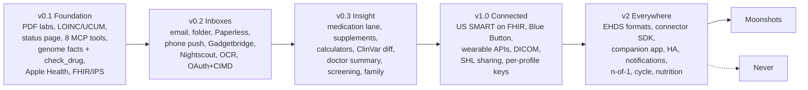

# Roadmap

OwnHealth is the health data layer you own: one store, two views. The web page shows health at a glance. The MCP server is the main interface for an outside agent such as Claude Code. There is no embedded chat agent and no built-in LLM.

This roadmap is ordered, not dated. A phase ships when its exit criteria pass, not on a calendar. Every exit criterion below is a test we can run, and most of them run in CI against synthetic fixtures (people in fixtures: Alex Rivera, Sam Rivera, Lucía Rivera (child), Carmen Ortega (parent)). Acronyms (PGx, CPIC, LOINC, UCUM, IPS, RCV, PAT, CIMD, SHL, ICE, EHDS, MDR) are expanded in the [glossary in PLAN.md](PLAN.md#glossary). The final project decisions are in [PLAN.md](PLAN.md#decisions).

## Overview

| Phase | One-line goal | Exit criteria (summary) |
|---|---|---|
| **v0.1 Foundation** | A family can import its lab PDFs, genome facts and Apple Health data, see current status, and query all of it from Claude Code with citations. | Synthetic Spanish 3-page lab report imports with >=98% of rows auto-accepted and 100% linked to page+bbox; `get_health_status` answers in <300 ms p95 under 2 KB with a stable `state_hash`; 8 MCP tools pass contract tests; restore test reproduces the same `state_hash`. |
| **v0.2 Inboxes** | Documents and device data arrive on their own, and scans become reviewable values without an embedded model. | An allowlisted, password-protected lab email reaches the review queue in <2 min; 100% of non-allowlisted mail is quarantined; a claude.ai remote connector connects over OAuth 2.1 with CIMD; scanned-page row F1 >=0.90 on the eval set. |
| **v0.3 Insight** | Turn the record into cited, deterministic answers: the full medication lane, risk calculators, screening, family patterns, a paper summary for the doctor. | `check_drug` covers 100% of CPIC level A pairs in fixtures with citations and no imperative advice; every calculator matches its published worked examples; doctor summary renders in es/en in <5 s. |
| **v1.0 Connected** | Pull live data where a self-hoster can register, open imaging, share safely, and protect each profile with its own key. | Epic sandbox patient connects and refreshes for 30 days; DICOM CD of 2,000 images opens in OHIF; SHL created in the UI opens in a reference viewer and revokes; crypto-shredding a profile leaves its blobs unreadable. |
| **v2 Everywhere** | Follow EHDS into EU formats, open the connector ecosystem, and reach phones and homes. | EU Patient Summary and HL7 Europe Lab example instances import with 0 silent drops; 3 community plugins pass the SDK conformance suite; Android companion reads Health Connect medical records into the review queue. |
| **Moonshots** | Hard, valuable, not committed. | Each gets a design doc and a spike before any code lands in main. |
| **Never** | Things we refuse, with reasons. | Stays empty of exceptions. |

### Rules that hold in every phase

- Provenance on every value: source document, page, bounding box. The printed value, unit and range are the truth layer; LOINC, UCUM and canonical values are derived and recomputable, except a LOINC code or UCUM unit the source itself sent, which is kept.
- Nothing silent: rejected rows, unconvertible units and low-confidence extractions go to the review queue.
- Imported text is untrusted. Free text over MCP carries `trust: untrusted_text`. No MCP tool creates an outbound share or export. Every agent write lands in the review queue.
- Information, not diagnosis. PGx quotes CPIC/DPWG and says "discuss with your prescriber".
- One app container plus Postgres. Heavy parts are opt-in compose profiles (`ocr`, `imaging`, `wearables`).
- Dark theme by default. Spanish and English from the first screen. SI and conventional units.

---

## v0.1 Foundation

**Goal.** The smallest release worth self-hosting: one family, PDF labs, genome facts, Apple Health, FHIR bundles, a current-state page, and the 8 MCP tools over personal access tokens (PATs), `check_drug` included.

### Deliverables

**Ingestion**
- [ ] Upload in the UI: PDF, image, Apple Health `export.zip`, FHIR R4 JSON/NDJSON bundle, OwnGenome output directory.
- [ ] Content-addressed immutable blob store (`blobs/sha256/ab/cd/...`); dedupe by file hash.
- [ ] PDF text layer extraction with pdfplumber / pypdfium2 (words + bboxes + font attributes).
- [ ] Document classifier: lab report / imaging report / discharge / prescription / genomics / other; profile, date and provider guessed, user confirms.
- [ ] Lab table extraction: generic table rules plus the fictional LabNorte template in v0.1. Real lab layouts (Synlab, Eurofins Megalab, Unilabs, Quest, Labcorp) arrive as contributed YAML templates under `ingest/pdf/vendors/<country>/`; we cannot test real-brand layouts under the synthetic-only fixture rule, so auto-accept is measured on synthetic layouts only.
- [ ] Draw/report grouping, including "ordered but missing from this draw" and amended reports that supersede an earlier edition.
- [ ] Apple Health `export.zip`: streaming `iterparse` of `export.xml` (never DOM), `clinical-records/*.json` as FHIR R4, ECG CSVs stored as documents, source-priority rule per metric to stop Watch + iPhone double counting, UTC plus original offset.
- [ ] Apple Health Medications from the export zip.
- [ ] Wearable samples table plus app-maintained hourly/daily rollups (min, max, mean, median, p10, p90, n, coverage %), filled by the Apple Health import.
- [ ] FHIR R4 bundle import: US Core and IPS (`Bundle` type `document` with `Composition`). Unhandled resource types go to the review queue as "stored, not projected".
- [ ] Manual entry for any observation, condition, allergy, vaccine, current medication; corrections stored as new versions.
- [ ] Auto-accept: a row is committed without a click only when every check passes, `row_conf >= 0.95`, the source allows it (known vendor template or generic rules on a native text layer, or a structured import with a valid code and unit) and identity matches. Everything else goes to the review queue ([ingestion.md section 9](design/ingestion.md#9-validation-and-acceptance)).

**Normalization**
- [ ] LOINC/UCUM resolver: v0.1 ships a curated 202-code LOINC 2.83 subset (`normalize/terminology/loinc/loinc_subset.tsv`, under the LOINC License with its notice) and a hand-written UCUM unit subset (`normalize/_units.py`). An analyte outside the subset lands in review as `loinc_unknown`. Mirobody's resolver overlays and a wider LOINC set move to a later phase.
- [ ] Multilingual alias table (es/en/de/fr first) as a reviewed data file in the repo; "add alias" action from the review queue.
- [ ] Resolution from name + unit + specimen, never name alone.
- [ ] Mass-to-molar conversion from a curated, cited molar-mass table per analyte.
- [ ] Unit-dimension vs LOINC-property validator to catch column shifts.
- [ ] Out-of-range flags from the lab's own printed range. No "optimal" range by default.
- [ ] Deterministic rule pack v1 (YAML): recency windows, lab range, trend, stale, never-measured, gene x drug, gene x lab. Output byte-reproducible with `state_hash`.

**Genome**
- [ ] Ingest `genome-facts.json` (`ownhealth.genome-facts/v1`) from [OwnGenome](https://github.com/GeiserX/OwnGenome), which does all genome compute, with schema validation; reject on version mismatch with a clear error.
- [ ] Copy the tabix-indexed VCF and its index into the blob store after their sha256 matches the facts file; raw genome files never enter the DB.
- [ ] `lookup_variant` reads the VCF plus the coverage map and returns explicit `call_state` (ref / alt / no_call / not_on_array / not_covered).
- [ ] Per-profile opt-in for sensitive findings (APOE e4, cancer and cardiac SF genes), one switch for the UI and one for agents; adult-onset, sensitive and carrier findings withheld for minors.
- [ ] Facts carry evidence E1-E4, confidence, DB versions; `not_assessed` listed explicitly.

**Records**
- [ ] Problem list, allergies, vaccinations, procedures as FHIR-shaped JSONB plus typed projection columns.
- [ ] Fact lifecycle: provisional, current, superseded, retracted, with reason and evidence link. Clinical verification of a condition or genome finding (provisional, confirmed) is kept beside it.
- [ ] Current medications from FHIR/IPS, Apple Health and manual entry, with start and stop dates; enough for `check_drug` and the `gene_drug` rule.
- [ ] Document vault with full-text search over the text layer (UI only; raw text over MCP needs `read:documents_text`). Non-lab documents are listed here by date and type.

**UI**
- [ ] Health at a glance: one card per body system with status (OK / Watch / Out / Stale / No data), 2-3 markers with sparklines, newest-data date, link to the rule that set the status.
- [ ] Biomarker detail: trend with the lab reference band, source chip per point, raw printed string on hover, unit toggle.
- [ ] Review queue split view: page with highlighted boxes on the left, extracted rows on the right; bulk accept above a threshold; reject with reason.
- [ ] Profile switcher; household roles `owner`, `guardian`, `caregiver`, `viewer` ([architecture.md section 6.2](design/architecture.md#62-ddl-sketch)); profiles without a login (a child, a parent) are managed through guardian or caregiver grants until claimed.
- [ ] Current medications strip with PGx badges on the dashboard.
- [ ] Settings: tokens (create, scope, revoke, last used), audit log viewer.
- [ ] Dark theme, es/en, WCAG AA contrast, status never by colour alone.

**MCP**
- [ ] Official MCP Python SDK at `/mcp`, streamable HTTP, spec 2026-07-28 with 2025-11-25 fallback.
- [ ] The 8 tools: `get_health_status`, `search_observations`, `get_trend`, `get_genome_findings`, `lookup_variant`, `check_drug` (PGx + current medications + relevant labs, CYP2D6 phenoconversion by the CPIC rule), `get_source`, `propose`.
- [ ] `propose` kinds live from v0.1: `observations`, `note`, `finding_status`, `medication`. All land in the review queue.
- [ ] Per-token identity mode (`full`, `pseudonymous`, `minimal`), language and unit preference, applied after the `state_hash` is computed.
- [ ] MCP resources (`ownhealth://profiles`, status, source, rules, access log) and the prompts `prepare-doctor-visit`, `check-before-new-drug`, `what-to-measure-next`.
- [ ] Hashed, scoped PATs; `tools/list` filtered by scopes; family access = role grants intersected with token scopes.
- [ ] Response rules: summary first, cursor pagination, `as_of`, ~4k token default, 15k max, `src` id on every fact, envelope `evidence` / `limitations` / `not_assessed` / `db_versions`.
- [ ] Per-token rate limit and daily egress budget; separate daily cap on `lookup_variant`. Defaults in [mcp.md section 9.4](design/mcp.md#94-rate-limits-and-egress-budgets).

**Security/Privacy**
- [ ] Passkeys by default with printed recovery codes; step-up auth for tokens, grants, export and deletion; optional OIDC (Pocket ID, Authentik, Authelia).
- [ ] Append-only audit log: which token or user read which resource, no payloads.
- [ ] Injection fixtures in CI: white-on-white text, metadata fields, OCR-only text, FHIR `Observation.note`.
- [ ] `trust: untrusted_text` on every free-text field over MCP.
- [ ] Intended-purpose statement in README and app footer: personal record keeping and display of values from published formulas.

**Ops/Distribution**
- [ ] `docker compose up` with one app image and Postgres 17; images pinned by semver, multi-arch (amd64, arm64), with an SBOM and cosign signatures.
- [ ] Postgres table job queue (`SELECT ... FOR UPDATE SKIP LOCKED`) in the app process.
- [ ] restic backup recipe with a scripted restore test.
- [ ] Full export from the UI only: FHIR R4 NDJSON plus original files in one zip.
- [ ] Migrations with forward-only versioning from the first release.

**Docs/Community**
- [ ] Quick start, architecture, MCP tool reference with example responses, threat model.
- [ ] Synthetic lab-slip generator and eval set (es/en/de/fr layouts, row-level ground truth), no real PII ever.
- [ ] CONTRIBUTING with "how to add a lab template" and "how to add an alias".

### Exit criteria

| Area | Criterion |
|---|---|
| Lab import | A synthetic 3-page Spanish lab report in the fictional LabNorte layout imports with >=98% of rows auto-accepted (coded to LOINC, every check passed, no click needed) and 100% of rows linked to page + bbox; the false auto-accept rate on the eval set is 0. |
| Nothing silent | Across the born-digital eval set, every ground-truth row has exactly one outcome, either accepted or in the review queue (never both, never twice), matched by row identity: 0 dropped, 0 duplicated. |
| Eval set | >=30 synthetic layouts across es/en/de/fr; text-layer row F1 >=0.97. |
| Status | `get_health_status` answers in <300 ms p95 and <2 KB for a profile with 5 years of labs; two runs give the same `state_hash`, and tokens with different language, unit and identity settings get the same hash. |
| MCP budget | No tool response exceeds 15k tokens on the largest fixture; default responses stay under 4k. |
| Scopes | A token without `read:genome` sees neither genome tools in `tools/list` nor genome facts in any other tool. |
| Injection | 0 injection fixtures reach an MCP response without the untrusted marker; 0 agent writes bypass the queue. |
| Apple Health | A 2 GB `export.xml` imports in <10 min with peak RSS <1 GB on a 4-core box (target, to measure). |
| FHIR/IPS | The HL7 IPS IG example bundles import with every resource either projected or queued. |
| Genome | `lookup_variant` returns a `call_state` for 100% of a 1,000-rsID test list, including sites not on the array; a contract test rejects any `call_state` outside `ref`, `alt`, `no_call`, `not_on_array`, `not_covered`. |
| Drug check | `check_drug` for the synthetic profiles quotes CPIC text verbatim with its level, lists current medications and relevant labs with `src` ids, and the wording lint finds 0 imperative phrases in text we write (quoted guideline text, attributed to its source, is exempt). |
| Restore | A restic restore into a fresh stack yields an identical `state_hash` for every profile. |
| Install | Fresh install to first imported lab in <10 min on a 4 GB RAM box. |

---

## v0.2 Inboxes

Ships in 0.3.0. Measured exit criteria: [v0.2-exit-criteria.md](v0.2-exit-criteria.md).

**Goal.** Data arrives without the user uploading it, and scanned documents become values through local OCR or an outside agent, never through an embedded model.

### Deliverables

**Ingestion**
- [x] Email-in: IMAP poll of a dedicated mailbox; per-profile routing; sender allowlist; everything else to quarantine.
- [x] Per-sender PDF password rules (for labs that lock PDFs with an ID number or birth date), stored encrypted.
- [x] Watched folder (scanner target, synced phone folder).
- [x] Paperless-ngx: "Document Added" webhook plus API pull of the original; Paperless ID kept as the source link.
- [x] PWA share target (Android) and an iOS Shortcut recipe for photos and PDFs.
- [x] Three-level dedup: file hash, document fingerprint, observation match (analyte + specimen time + value + lab).

**Normalization**
- [x] `ocr` compose profile: PaddleOCR PP-StructureV3 or Docling on CPU; PaddleOCR-VL 0.9B on GPU/iGPU. Shipped as PP-OCRv5 mobile detection and Latin recognition on ONNX Runtime, in Rust, on CPU (a GPU execution provider is optional), because OwnHealth carries no Python; the engine choice and its numbers are in [ocr-benchmark.md](ocr-benchmark.md).
- [x] OCR only for scans, photos and pages with garbage glyphs; text layer stays first.
- [x] Grounding check: every extracted value must match the page word layer, or it goes to review flagged ungrounded.
- [x] Benchmark harness: pages/s and row F1 per engine on the eval set, published in docs.

**Wearables**
- [x] Health Auto Export receiver (JSON v2, scheduled push).
- [x] Gadgetbridge SQLite DB import (fully offline wearables).
- [x] Nightscout pull (`/api/v1/entries/sgv.json`, v3 API), including FreeStyle Libre via Nightscout connect.
- [x] CGM readings under LOINC 99504-3; summary per the HL7 CGM IG profiles (mean glucose 97507-8, GMI, times-in-ranges panel 106793-3); validity >=70% sensor wear over 14 days per the international time-in-range consensus.

**MCP**
- [x] `list_pending_documents` and `get_document_page` for agent-assisted extraction; the agent calls `propose` with page + bbox.
- [x] OAuth 2.1 resource server: RFC 9728 protected-resource metadata, RFC 8707 audience checks, Client ID Metadata Documents (CIMD). DCR only if a client we use needs it.
- [x] Review queue shows which documents were in the agent's context for each proposal (from the audit log).

**UI**
- [x] Inbox screen: sources, last run, errors, quarantine with "allow sender" action.
- [x] Review queue ungrounded/low-confidence highlighting; duplicate banner.

**Security/Privacy**
- [x] Quarantine never parsed into observations until a human releases it.
- [x] Injection fixtures added for email bodies, Paperless notes and OCR-only text.
- [x] Remote LLM extraction is not a feature; extraction off-box only happens in the user's own agent, through MCP.

**Ops/Distribution**
- [x] Profile images built per compose profile (`<version>` and `<version>-ocr`, pushed by the release workflow on the tag); default image stays without OCR models.
- [x] Health endpoint per source with "last successful sync" for alerting.

**Docs/Community**
- [x] Recipes: Paperless-ngx, scanner to folder, Health Auto Export, Nightscout, claude.ai remote connector over a tunnel.
- [x] "Agent-assisted extraction" walkthrough with Claude Code.

### Exit criteria

| Area | Criterion |
|---|---|
| Email | A password-protected lab PDF from an allowlisted sender appears in the review queue in <2 min; 100% of mail from other senders lands in quarantine. |
| OCR | Scanned and photographed eval pages reach row F1 >=0.90 on CPU; CPU throughput measured and published (target <60 s per page, unverified). |
| Nothing silent, scans | With the `ocr` profile on, every ground-truth row of the scanned and photographed eval set has exactly one outcome, accepted or in the review queue: 0 dropped, 0 duplicated. With it off, every such page waits as pending and is listed by `list_pending_documents`. |
| Agent extraction | A Claude Code session using only MCP extracts a scanned page; 100% of proposals land in the queue; every ungrounded value is flagged. |
| OAuth | claude.ai connects as a remote connector through CIMD with no DCR; audience mismatch is rejected in tests. |
| Phone push | 7 days of 15-min Health Auto Export pushes import with 0 duplicate samples. |
| CGM | 14 days of Nightscout data give TIR within 1 percentage point of Nightscout's own report. |
| Paperless | A document tagged `health` in Paperless-ngx shows in the queue with its Paperless link within 1 min of the webhook. |

---

## v0.3 Insight

**Goal.** Cited, deterministic answers that matter in a visit: drug checks, risk calculators, screening, family patterns, a paper summary.

### Deliverables

**Records**
- [ ] Full medication lane: dose, schedule, start/stop, reason, prescriber; supplements as first-class records with label photo and a decision (`keep`, `stop`, `do not repurchase`) with reason.
- [ ] Optional codes: RxNorm, national drug codes, ATC codes only as received (ATC content never shipped).
- [ ] Family history and pedigree: relative records (including deceased), conditions with age at onset, GEDCOM import (structure only), FHIR FamilyMemberHistory export.
- [ ] Cross-profile hints: cited rules where a finding in one relative suggests a test in another, with consent per relative.
- [ ] Timeline: visits, diagnoses, meds as bars, labs as dots, imaging, genome runs, documents; episodes; document-gap tracker with a GDPR Art. 15 request letter template.
- [ ] IPS summary export (FHIR `document` Bundle plus printable PDF, es/en) from the UI.
- [ ] Ownership transfer at majority: the young adult claims the profile; guardian grants drop or are re-granted by the new owner.

**Genome**
- [ ] `check_drug` widened: supplements in the medication join, the inhibitor table beyond CYP2D6 named per gene, DPWG text beside CPIC.
- [ ] Weekly ClinVar VCF diff by VariationID against each person's calls; alerts only on upgrades to P/LP with >=1 star, downgrades of shown P/LP, SF-gene changes.
- [ ] Consumer chips via OwnGenome (local Beagle imputation default), with hard caps: rare P/LP from arrays always "unconfirmed" (PPV ~16%, PMID 33589468).
- [ ] Couple carrier view from OwnGenome carrier facts.
- [ ] CPIC and PharmCAT staleness check: PGx facts marked stale when a newer guideline or release supersedes their `db_versions`.
- [ ] Relatedness QC: genotype fingerprints of family profiles compared at import; unexpected pairs go to review.

**Normalization / calculators**
- [ ] Calculators as versioned, cited code with validity rules: CKD-EPI 2021 (creatinine and creatinine-cystatin C), PREVENT, SCORE2 / SCORE2-OP by risk region, FIB-4 (not valid under 35; from 65 the low cutoff is 2.0 instead of 1.3), HOMA-IR (same-specimen pairing), PhenoAge (single complete draw only).
- [ ] Reference change value (RCV) from EFLM biological variation data.
- [ ] Method-change markers on trends (assay or lab change).
- [ ] Personal-baseline anomalies (a value outside the person's own usual range, not only the lab's) and critical-value alerts (values past published critical limits), both as cited rules in the rule pack.

**Prevention**
- [ ] Screening and vaccine rules as cited YAML per country: PAPPS (Spain) and USPSTF first. Each rule: age, sex, risk modifiers, interval, citation URL.
- [ ] Reminders inbox: retests, screenings, vaccines, document requests; snooze, done with evidence, dismiss with reason; ICS feed per profile.
- [ ] Next-draw planner: overdue, abnormal follow-up, never measured; pre-draw conditions; printable request.

**UI**
- [ ] Medications screen: history, schedules, supplements and decisions, with PGx badges and a "check a drug" box.
- [ ] Genome screen: PGx gene grid, carrier, monogenic, PRS with ancestry caveat, raw lookup; sensitive findings behind a reveal.
- [ ] Family screen: pedigree canvas, patterns list, name-hiding toggle for screenshots.
- [ ] Printable doctor summary (es/en), two A4 pages, light print theme, specialty templates (GP, cardiology, endocrinology, hematology).

**MCP**
- [ ] `get_health_status` gains supplement, screening and family sections within the same 2 KB budget.
- [ ] Evaluate later candidates (`timeline`, `what_changed_since`, `list_conditions`, `get_medications`) against logged agent sessions; add only those with evidence (see "How we decide").

**Security/Privacy**
- [ ] Wording lint in CI: PGx and calculator outputs never contain imperative treatment advice ("do not take", "stop") in text we write. A verbatim guideline quotation, attributed to its source, is exempt.
- [ ] Per-relative consent for cross-profile hints; minors' data never feeds hints to non-guardians.

**Docs/Community**
- [ ] One page per calculator: formula, version, citation, validity limits, worked example.
- [ ] Guideline YAML contribution guide; a reviewer of record per country file.

### Exit criteria

| Area | Criterion |
|---|---|
| Drug check | `check_drug` answers for 100% of CPIC level A gene-drug pairs present in fixtures, each with a guideline citation, supplements included in the medication join; the wording lint finds 0 imperative phrases outside attributed guideline quotations. |
| Calculators | Every calculator reproduces its published worked examples to the stated precision and refuses (with reason) when a validity rule fails. |
| ClinVar diff | Weekly diff for a household of 4 genomes finishes in <5 min; alert-policy fixtures fire exactly on the 3 alert classes. |
| Chips | A synthetic array with a planted rare P/LP shows it as "unconfirmed" with the PPV note, never as confirmed. |
| Doctor summary | Two-page PDF renders in es and en in <5 s; every number on it has a `src` id. |
| Screening | Every PAPPS and USPSTF rule has a citation URL; CI fails on a missing one. |
| Status budget | `get_health_status` still <2 KB and <300 ms p95 with supplements and screening added. |

---

## v1.0 Connected

**Goal.** Live connections where a self-hoster can register, imaging in the browser, sharing only by a human click, and per-profile encryption.

### Deliverables

**Records/connectors**
- [ ] US SMART on FHIR patient standalone launch (PKCE) for Epic, Oracle Health, athenahealth, eClinicalWorks, MEDITECH, NextGen, VA Lighthouse; endpoint directory built from vendor Brands bundles.
- [ ] Bring-your-own client wizard: the self-hoster registers a read-only, patient-facing US Core/USCDI client per vendor. A shared project client is an open decision (below).
- [ ] CMS Blue Button 2.0 (CARIN BB, `ExplanationOfBenefit`, `Coverage`), bring-your-own registered confidential client.
- [ ] C-CDA import (US CCD) through an open CDA-to-FHIR mapper.
- [ ] SMART Health Links and SMART Health Cards receiver (QR scan or paste).
- [ ] Refresh-token rotation persisted atomically before use.

**Wearables**
- [ ] `wearables` profile: Open Wearables (MIT) sidecar, pinned release, pulled over its REST API. The sidecar's Strava provider is disabled, and the `openwearables` connector drops any sample whose provider is `strava`.
- [ ] Oura, Whoop v2, Polar AccessLink, Withings, Dexcom v3 through the sidecar; guided per-provider setup page (redirect URI, scopes).
- [ ] Polar and Dexcom rolling windows: scheduled syncs from day one, alert on a sync gap.
- [ ] File importers: Garmin "Export Your Data" (FIT + JSON), Google Takeout Fitbit, Strava bulk export, LibreView and Dexcom Clarity CSV.
- [ ] Vendor scores (readiness, recovery, Body Battery) stored apart from measurements, tagged `computed_by: provider`.
- [ ] HRV tagged by method; never compared across vendors.

**Imaging**
- [ ] `imaging` profile: Orthanc + OHIF as separate containers.
- [ ] DICOM import from CD folders and zips; study linked to its report document and to the timeline.

**UI**
- [ ] SMART Health Links sharing from the UI only: scope picker, expiry, optional PIN, access log, revoke. The ciphertext goes to a host the user controls (the instance behind a tunnel, or their own static or S3 host); the project runs no share host.
- [ ] ICE card: printable wallet card, offline QR with minimal plain text, optional SHL QR for the full IPS.
- [ ] Household overview: one row per member with flags and overdue items.
- [ ] Connections screen: status, last sync, token expiry per source.

**Security/Privacy**
- [ ] Per-profile data keys (DEKs) for blobs and genome files, wrapped by a household key; crypto-shredding on profile deletion.
- [ ] Hash-chained audit log, user-visible.
- [ ] Break-glass for family: a grant that activates after a delay unless the owner cancels it; every use audited and notified.
- [ ] Threat model updated for live connectors and sharing; external security review before tagging 1.0.

**MCP**
- [ ] `get_imaging_studies` if logged sessions show the need (metadata and report only, no pixel data).
- [ ] Sidecar vendor metrics (Oura, Whoop, Polar, Withings, Dexcom) in `search_observations` and `get_trend`, with LTTB or min/max downsampling for long windows.

**Ops/Distribution**
- [ ] Upgrade path tested from every 0.x release to 1.0 with no data loss.
- [ ] S3/Garage blob backend option.
- [ ] Monthly partitions + BRIN for samples only past ~50M rows, with a migration job.

**Docs/Community**
- [ ] More UI languages: de, fr, ca, it, pt.
- [ ] Per-connector pages with the vendor's AI and data-use terms quoted and linked.

### Exit criteria

| Area | Criterion |
|---|---|
| SMART | An Epic sandbox patient connects, imports US Core resources, and refreshes daily for 30 days without re-consent. |
| Blue Button | A sandbox synthetic beneficiary imports claims with 0 silent drops. |
| Wearables | 30 days of Oura, Withings and Dexcom sandbox sync with 0 missed gap alerts; Polar gap alert fires within 24 h of a missed sync. |
| Imaging | A DICOM CD with 2,000 images imports and its study opens in OHIF in <5 s on a LAN. |
| Sharing | An SHL created in the UI opens in a reference SHL viewer, expires on time, and returns nothing after revoke; no MCP call can create one. |
| Keys | After crypto-shredding Sam Rivera's profile, a test cannot decrypt any of Sam's blobs from a backup. |
| Break-glass | A grant activates exactly after its delay, cancels cleanly, and writes audit + notification on every use. |
| Upgrade | Fixture databases from 0.1, 0.2 and 0.3 migrate to 1.0 with identical `state_hash` for unchanged data. |

---

## v2 Everywhere

**Goal.** Meet the EU formats as EHDS lands, let others write connectors, and reach phones and homes.

### Deliverables

**Records/connectors**
- [ ] EU Patient Summary and HL7 Europe Laboratory Report importers (Patient Summary due 2029-03-26; labs, discharge and imaging 2031-03-26).
- [ ] Hospital Discharge Report and Imaging Report importers as their IGs stabilize.
- [ ] Italy FSE 2.0: extract the embedded CDA2 from PAdES-signed PDFs before any OCR.
- [ ] Taiwan My Health Bank JSON importer.
- [ ] HL7 v2 ORU^R01 and lab CSV importers.
- [ ] Connector SDK (`list_documents()`, `fetch(document)`, conformance tests) and a separate community plugins repo.
- [ ] Opt-in browser-session plugins in the community repo: Spanish CCAA portals behind Cl@ve, HCDSNS, La Meva Salut, sundhed.dk, Quirónsalud. Run locally in Playwright, never store eID credentials, manual 2FA each run.
- [ ] GDPR / HIPAA access-request letter generator per country.

**Wearables**
- [ ] Companion app: Android Health Connect (fitness and medical records FHIR), iOS HealthKit with anchored queries; or adopt Open Wearables' SDK app if it ships.
- [ ] Samsung Health through Health Connect.
- [ ] Nutrition lane: Cronometer, MyFitnessPal, MacroFactor exports; `get_dietary_constraints`-style data for outside meal planners if sessions show the need.
- [ ] Cycle lane under `read:sensitive`: Clue/Flo/Natural Cycles exports, Apple and Health Connect cycle data.
- [ ] Training lane: Hevy, Strong CSV.

**Insight**
- [ ] n-of-1 experiments: hypothesis, baseline, intervention, washout, outcome with RCV, honest "inconclusive".
- [ ] Correlation explorer with sample size shown and no automatic "top correlations".
- [ ] Pedigree-aware screening; more guideline sets (NHS, G-BA, one LatAm set).
- [ ] Successor and inheritance of data: owner names a successor per profile; crypto-shredding otherwise.

**Integrations out**
- [ ] Home Assistant integration (MQTT discovery: next due item, latest BP, days since last lab).
- [ ] Prometheus exporter, opt-in per marker, pseudonymous profile label.
- [ ] Notifications: ntfy, Gotify, email, Telegram.
- [ ] Webhooks on new result, new flag, reminder due.

**Genome**
- [ ] FHIR Genomics Reporting IG export, from the UI only.
- [ ] HPO codes on conditions for genome-phenotype matching.

### Exit criteria

| Area | Criterion |
|---|---|
| EHDS | HL7 Europe Patient Summary and Lab IG example instances import with every resource projected or queued. |
| Italy | A synthetic FSE PDF with embedded CDA2 yields coded lab rows with 0 OCR calls. |
| SDK | 3 community plugins pass the SDK conformance suite; a broken plugin cannot crash the app (process isolation test). |
| Companion | The Android app reads Health Connect medical records into the review queue; iOS app syncs incrementally for 7 days with no duplicates. |
| Notifications | Each channel delivers a test reminder; no notification body contains a lab value unless the user opts in. |
| HA | Sensors appear through MQTT discovery and update within 1 min of a new result. |

---

## Provider coverage ladder

Tiers:
- **T0 Universal**: PDF/photo upload, email-in, watched folder, manual entry. Works in every country.
- **T1 Standard file**: FHIR/IPS/EU PS bundles, C-CDA, CDA-in-PDF, Apple Health zip, national JSON, DICOM.
- **T2 Live API**: patient-authorized OAuth a self-hoster can register for.
- **T3 Browser-session plugin**: opt-in, community repo, "may break".
- **T4 Legal-entity API**: needs a company and certification. Not on our roadmap.

### Clinical records

| Country / provider | T0 | T1 | T2 | T3 | T4 (not planned) |
|---|---|---|---|---|---|
| Spain, SNS (HCDSNS, Mi Carpeta de Salud, La Meva Salut, GVA+Salut, other CCAA) | v0.1 PDF, v0.2 email/folder | EU PS PDF v0.1 (as PDF); EU PS FHIR v2 | none exists | v2 (Cl@ve portals, La Meva Salut) | none |
| Spain, private (Quirónsalud, Sanitas, HM, Vithas) | v0.1 PDF, v0.2 email | none | none | v2 (Quirónsalud) | none |
| Spain, labs (Synlab, Eurofins Megalab, Unilabs) | v0.1 vendor templates, v0.2 email + PDF passwords | none | none | none | none |
| USA, EHRs (Epic, Oracle Health, athena, eCW, MEDITECH, NextGen, VA) | v0.1 | v0.1 Apple Health clinical records, FHIR bundles; v1.0 C-CDA, SHL | v1.0 SMART on FHIR | none | TEFCA IAS |
| USA, payers (Medicare, MA, Medicaid) | v0.1 | v0.1 FHIR bundles | v1.0 Blue Button 2.0; payer APIs per payer after 1.0 | none | none |
| USA, labs (Quest, Labcorp) | v0.1 templates | via EHR FHIR | via EHR SMART v1.0 | none | none |
| Canada (Epic/Cerner sites) | v0.1 | v0.1 Apple Health zip | v1.0 SMART on FHIR | none | none |
| UK (NHS App) | v0.1 | v0.1 Apple Health zip (few trusts) | none | v2 candidate | IM1, GP Connect |
| Germany (ePA für alle) | v0.1 | none known (unverified) | none | none | DiGA route |
| France (Mon espace santé) | v0.1 | v2 if DMP CDA download exists (unverified) | none | none | referenced-app APIs |
| Italy (FSE 2.0) | v0.1 | v2 CDA2 from signed PDF | none | none | none |
| Netherlands | v0.1 | v2 if a PGO exports FHIR (unverified) | none | none | MedMij PGO |
| Denmark (sundhed.dk) | v0.1 | none | none | v2 (dhroxy pattern) | none |
| Norway (Helsenorge), Sweden (1177), Finland (OmaKanta) | v0.1 | none | none | v2 candidates | none |
| Portugal, Belgium, Estonia, Switzerland | v0.1 | v2 EU PS when offered | none | none | none |
| Taiwan (My Health Bank) | v0.1 | v2 JSON importer | none | none | SDK |
| India (ABDM) | v0.1 | v0.1 if the user exports a FHIR bundle | none | none | HIU/PHR |
| Japan, Korea, Australia | v0.1 | v0.1 FHIR bundles if exported | none | none | Mynaportal, MyHealthway, MHR Gateway |
| Brazil, Mexico, Argentina, Chile, Colombia | v0.1 PDF, v0.2 email | none | none | v2 candidate (Meu SUS Digital) | RNDS |
| Any EU country, any provider | v0.1 | v2 EEHRxF downloads as each state delivers them | none | none | none |

### Wearables and devices

| Source | Phase | Path |
|---|---|---|
| Apple Health (all devices that write to it) | v0.1 zip; v0.2 Health Auto Export push; v2 companion app | file, push, app |
| Gadgetbridge (Amazfit, Bangle.js, Pebble, many Huawei/Xiaomi bands) | v0.2 | SQLite file |
| Nightscout, FreeStyle Libre via Nightscout | v0.2 | REST pull |
| Oura, Whoop v2, Polar, Withings | v1.0 | Open Wearables sidecar |
| Dexcom v3 | v1.0 | native connector, or Nightscout from v0.2 |
| Garmin | v1.0 | GDPR export (FIT + JSON); ongoing via Apple Health / Health Connect |
| Fitbit | v1.0 | Google Takeout; ongoing via Health Connect |
| Strava | v1.0 | bulk export only, never the API |
| Samsung Health | v2 | Health Connect companion |
| Cronometer, MyFitnessPal, MacroFactor, Hevy, Strong, Clue, Flo, Daylio, Bearable | v2 | CSV/JSON exports |
| Coros, Suunto | v1.0 | FIT export files; ongoing via Apple Health / Health Connect |
| Ultrahuman, Huawei cloud | not planned | partner approval only; via Apple Health / Health Connect |

---

## Moonshots

Not committed. Each needs a design doc and a spike before code reaches main.

| Moonshot | Why | The hard part |
|---|---|---|
| **Phenopackets v2 export** | The rare-disease clinic hand-off format: genome + HPO phenotype + family in one file. | Clean HPO coding of conditions we mostly receive as free text; mapping our finding lifecycle onto Phenopackets interpretation status. |
| **Household-to-household encrypted sync** | Adult children and parents run separate instances but need shared family history and break-glass across them. | Key exchange between instances without a central server; conflict resolution on shared relative records; revocation that actually removes data from the other side. |
| **Local-first encrypted mobile replica** | The record works offline in a hospital basement, and an ICE view never depends on the home server being up. | Partial replication under per-profile keys; device loss; keeping the replica read-only so the review queue stays the only write path. |
| **Consent-based research donation** | People want to give their data to studies on their terms. | Real de-identification of genome + rare conditions is close to impossible; consent records that survive revocation; GDPR Art. 9 and ethics approval per study. |
| **Federated anonymous biomarker reference ranges** | Lab ranges differ by country and population; many instances could compute better age/sex/ancestry ranges together. | Privacy: secure aggregation or differential privacy with small cohorts; lab method differences poison pooled data; abuse by fake instances. |
| **Imaging AI via an outside agent over MCP** | The user's own agent reads a CT slice or an X-ray next to the report. | DICOM frames are large: windowing, slice selection and token budgets; de-identifying burned-in text; keeping it information, not diagnosis (MDR Rule 11). |
| **Voice and photo intake from the phone share sheet** | "Took ibuprofen 400 mg" or a photo of a supplement label becomes a queued proposal in seconds. | Doing speech-to-text and label parsing without an embedded model: either on-device OS features or the user's agent; both must land in the review queue. |
| **Public connector marketplace** | Portals change every month; a community can keep up where a single team cannot. | Signed plugins, sandboxing, review of code that runs with the user's eID session; legal exposure per portal's terms. |
| **EHDS certified EHR-system path** | From 2029 EU EHR systems must handle EEHRxF; certification would let OwnHealth sit inside official exchange. | Conformity assessment, a legal entity, support obligations; it pulls the project toward "commercial activity" under MDR and CRA. |

---

## Never

| Never | Reason |
|---|---|
| A Strava API connector | Strava's API policy (June 2026) bans AI use, context-window ingestion and MCP exposure of API data. We import the user's own bulk export only. |
| An embedded chat agent or built-in LLM | OwnHealth is the data layer; the user picks the agent. MCP Sampling is deprecated in 2026-07-28. An embedded agent adds cost, a model supply chain and a second place where data leaves. |
| Shipped SNOMED CT or WHO ATC content | SNOMED CT needs an affiliate licence outside member countries; ATC is not redistributable. We store codes as received; bring your own terminology. |
| Running genome engines inside the app | OwnGenome does all genome compute, including chips. Engines bring a JVM and heavy pipelines into a one-container app. |
| An MCP tool that shares, exports or emails | Imported text is untrusted; an outbound tool completes the exfiltration path. Sharing is a human click in the UI. |
| A single composite "health score" | One number hides everything and implies precision we do not have. Per-system cards with a "stale" state instead. |
| Central aggregation infrastructure for US endpoints | Running it is what pushed the open-source Fasten off live EHR pulls. Each instance connects for itself. |
| openEHR or OMOP as a store | Out of scope; FHIR at the edges, our own tables inside. |
| TimescaleDB, Redis or a JVM in core | Plain Postgres covers the load; compression needs the non-OSI TSL edition; fewer moving parts. |
| Imperative treatment advice | "Do not take X" is a therapeutic decision. We quote guidelines and say "discuss with your prescriber". |

---

## How we decide what's next

Inside a phase, order is set by these signals, strongest first:

1. **A failing exit criterion.** Nothing in a later phase starts while a current exit criterion is red.
2. **Real agent sessions.** We log (with consent, no payloads) which tools an agent calls, which calls return `not_assessed` or hit the token budget, and which questions needed three calls where one would do. A new MCP tool needs at least one recorded session that shows the gap. Candidate tools (`timeline`, `what_changed_since`, `get_imaging_studies`, `list_conditions`, `get_medications`) wait for this.
3. **User issues with a document attached.** A synthetic or redacted sample of an unsupported lab layout, portal export or device file. A layout with a sample beats one without.
4. **Review queue statistics.** The analytes, units and layouts that most often land in review tell us which aliases and templates to add next.
5. **Regulation and vendor dates.** EHDS milestones, vendor API shutdowns and terms changes (Oura, Withings, Google Health API) move items earlier or later.
6. **Cost to the self-hoster.** Between two equal items, the one that adds no container and no RAM wins.

What does not move the roadmap: a feature a rival has, a request with no sample, a model release.

---

## Open decisions

| Decision | Options | Note |
|---|---|---|
| US SMART client strategy | bring-your-own client wizard vs also a shared project public client with a static relay page | We ship bring-your-own in v1.0. A shared client puts our name on the consent screen and needs a relay we run, so it stays open ([connectors.md section 7](design/connectors.md#7-us-smart-on-fhir-registration-strategy)). |
| SHL ciphertext host | a host the user controls vs a reference share-host component we publish | We ship "a host the user controls" (the instance behind a tunnel, or their own static or S3 host). A reference component is open. |
| Unofficial wearable libraries (python-garminconnect, pydexcom Share, Eight Sleep) | never vs community plugins with ToS warnings | Not in the core plan; fragile and ToS-risky. |
| Oura and Withings terms | ship in v1.0 vs hold | Oura's 2026 agreement reportedly restricts AI processing (unverified); a Withings+ requirement for new accounts is reported (unverified). Read primaries before shipping. |
| Emergency card timing | v1.0 vs earlier | We keep the ICE card in v1.0, next to SHL sharing. |
| Notifications timing and library | v2 vs v0.3 with reminders; Apprise vs per-channel code | Reminders exist from v0.3 but deliver via ICS until v2. |
| LOINC distribution | curated subset in repo vs install-time download | Depends on the Regenstrief notice terms for a public repo. |
| Default OCR engine | PP-StructureV3 vs Docling on CPU | Decided by the v0.2 benchmark, not by preference. |
| Drug-drug interactions | skip vs non-commercial dataset as optional plugin | No clean open-licence DDI source known. |
| MDR status of a non-commercial open-source PHR | stay non-commercial with careful intended purpose vs legal opinion first | Unverified; the Blue Guide's "commercial activity" test is the next thing to read. |

## Sources

https://github.com/GeiserX/OwnGenome
https://github.com/thetahealth/mirobody
https://github.com/thetahealth/mirobody/blob/main/LICENSE-3RD-PARTY
https://github.com/fastenhealth/fasten-onprem
https://github.com/the-momentum/open-wearables
https://github.com/jmandel/health-skillz
https://fhir.epic.com/Documentation
https://bluebutton.cms.gov/developers
https://www.cms.gov/interoperability
https://en.wikipedia.org/wiki/European_Health_Data_Space
https://build.fhir.org/ig/HL7/fhir-ips/
https://build.fhir.org/ig/HL7/cgm/
https://loinc.org/99504-3
https://pubmed.ncbi.nlm.nih.gov/27775077/
https://github.com/jkiddo/dhroxy
https://www.nhi.gov.tw/ch/cp-5886-87fc9-3344-1.html
https://www.strava.com/legal/api_policy
https://sahha.ai/blog/health-api-ai-restrictions/
https://developer.android.com/health-and-fitness/health-connect/medical-records
https://github.com/Lybron/health-auto-export/wiki/API-Export---JSON-Format
https://gadgetbridge.org
https://github.com/nightscout/nightscout-connect
https://docs.paperless-ngx.com/api/
https://pharmcat.org
https://biologicalvariation.eu
https://www.semfyc.es/evidencia-cientifica/programas-semfyc/programa-de-actividades-preventivas-y-de-promocion-de-la-salud-papps
https://www.uspreventiveservicestaskforce.org/apps/api.jsp
https://health.ec.europa.eu/document/download/b45335c5-1679-4c71-a91c-fc7a4d37f12b_en?filename=mdcg_2019_11_en.pdf
https://pubmed.ncbi.nlm.nih.gov/33589468/
