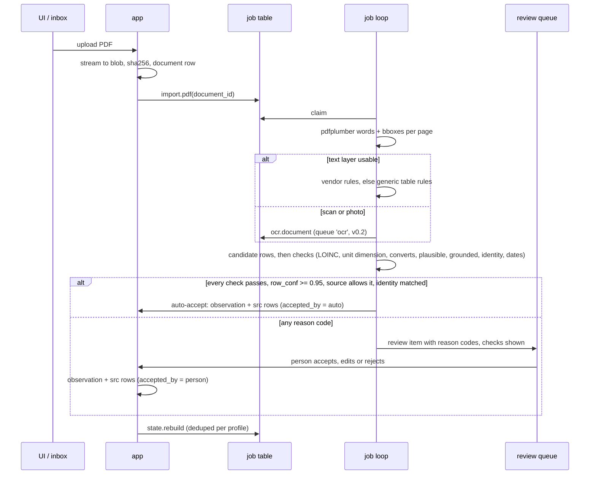

# Architecture and data model

This document says how OwnHealth is built: the processes, the containers, the database tables, the job queue, the blob store, the FHIR edges, the rule pack that builds each person's current state, and how we back it up, upgrade it, watch it and test it. It is the starting point for the first commit of code.

Status: plan. Nothing here is built yet.

## 1. Shape in one paragraph

OwnHealth is one Rust binary plus PostgreSQL 17. The binary serves the REST API (axum), the MCP server at `/mcp` (rmcp, the official Rust MCP SDK, streamable HTTP), the web UI (SvelteKit built to static files and embedded in the binary) and an in-process job loop that reads a Postgres table queue. Up to 0.1.1 the same process was Python 3.13 with FastAPI; 0.2.0 replaced it with the Rust server and kept the schema, the API and the data as they were. Documents and other files are content-addressed immutable blobs on disk. Clinical data lives in our own Postgres tables: each row keeps a FHIR R4-shaped JSONB copy plus typed projection columns for queries. FHIR is the format at the import and export edges only. Heavy parts are opt-in compose profiles: `ocr`, `imaging`, `wearables`. There is no embedded LLM and no chat: the outside agent talks to the MCP server.

## 2. Components

```mermaid
flowchart LR
  subgraph Clients
    BR[Browser / PWA<br/>dark, es + en]
    AG[Outside agent<br/>Claude Code, other MCP clients]
  end

  subgraph Core["app container (one Rust process)"]
    UI[Static SvelteKit UI]
    API[axum REST /api]
    MCP[MCP server /mcp<br/>8 tools]
    AUTHZ[authz: one permission function<br/>token scopes ∩ grant minus profile locks]
    ING[Importers<br/>PDF text layer, FHIR/IPS,<br/>Apple Health zip, genome facts, manual]
    NORM[Normalizer<br/>LOINC, UCUM, ranges, grounding]
    STATE[State engine<br/>versioned rule pack]
    JOBS[Job loop<br/>SKIP LOCKED queue]
    AUD[Audit writer]
    MET[/metrics]
  end

  PG[(PostgreSQL 17<br/>clinical tables, samples,<br/>jobs, review, audit)]
  BLOB[(Blob store<br/>blobs/sha256/ab/cd/...)]

  subgraph Profiles["opt-in compose profiles"]
    OCR[ocr worker<br/>same code, OCR extras]
    ORT[Orthanc + OHIF]
    OW[Open Wearables sidecar]
  end

  OG[OwnGenome output<br/>genome-facts.json + VCF.gz + .tbi]
  RS[(restic repository)]

  BR --> UI
  BR --> API
  AG --> MCP
  API --> AUTHZ
  MCP --> AUTHZ
  AUTHZ --> PG
  API --> AUD
  MCP --> AUD
  AUD --> PG
  JOBS --> ING --> NORM --> PG
  ING --> BLOB
  JOBS --> STATE --> PG
  OCR -- claims queue 'ocr' --> PG
  OCR --> BLOB
  API -- proxy /dicom-web, authz checked --> ORT
  JOBS -- pull REST --> OW
  OG -- import job --> ING
  PG --> RS
  BLOB --> RS
```

Rules that follow from the diagram:

- The UI, the REST API and the MCP server call the same query functions through the same `authz` function. Anything the UI can show, MCP returns under the same check, and vice versa. There is no second permission model.
- Orthanc, OHIF and Open Wearables are never exposed directly. Orthanc has no notion of our profiles, so the app proxies `/dicom-web/*` and checks that the StudyInstanceUID belongs to a profile the caller can read.
- OwnGenome runs elsewhere. OwnHealth never runs a genome engine; it imports OwnGenome's output.

## 3. Process model

| Part | How it runs |
|---|---|
| HTTP server | axum on tokio, one process. Routes: `/api/*`, `/mcp`, `/.well-known/*`, `/healthz`, `/readyz`, `/metrics`, and the static UI at `/` |
| MCP | rmcp's streamable HTTP service mounted at `/mcp`. Spec 2026-07-28 is stateless (no `initialize` handshake, no `Mcp-Session-Id`), so no session affinity is needed. We keep the 2025-11-25 fallback for older clients |
| Job loop | `N` tokio tasks started with the server (default `N=2`). Each claims one job, runs it, commits. CPU-bound and file-bound steps (PDF text layer, Apple Health XML, rollups, export zips) run on tokio's blocking threads so they never stall requests |
| OCR | Not in the core image. The `ocr` profile runs the same code from the image `ownhealth-ocr` with `OWNHEALTH_ROLE=worker` and `OWNHEALTH_QUEUES=ocr`: no HTTP server, only the job loop for the `ocr` queue |
| Scheduler | A row in `job` with `run_after` is a timer. Recurring jobs (rollups, restore check, ClinVar diff in v0.3) re-enqueue themselves on completion. No cron daemon |
| Static UI | `adapter-static` output embedded in the release binary (`rust-embed`) at image build time. No Node at runtime |

One process is enough for a family. A household has a few users and one or two agents, and the slow work goes through the queue. The stateless MCP spec means a second replica would work behind a load balancer later, but we do not plan for it.

Libraries in the core: axum, tower and tokio; sqlx for Postgres (queries checked at run time, so the build needs no database); rmcp (official MCP SDK); pdfium-render over a pinned PDFium build loaded at run time; noodles for the bgzipped VCF and its tabix index; quick-xml for the Apple Health export; webauthn-rs for passkeys; openidconnect for the optional OIDC client; jsonschema, serde_yaml and zip. The migrations, the rule pack, the CPIC snapshot, the LOINC subset and the vendor templates are compiled into the binary.

## 4. Compose profiles

| Profile | Services | Image size, RAM (estimates, unverified) | Ships in |
|---|---|---|---|
| (default) | `app`, `db` | app under 400 MB image; app plus Postgres about 0.5 GB RAM idle | v0.1 |
| `ocr` | `ocr` (PaddleOCR PP-StructureV3 or Docling on CPU; PaddleOCR-VL 0.9B on GPU or iGPU) | several GB image; 2 to 8 GB RAM while working | v0.2 |
| `imaging` | `orthanc` with the DICOMweb and OHIF plugins | 100 to 300 MB RAM idle | v1.0 |
| `wearables` | `open-wearables` plus its own Postgres and Redis | brings Redis and Celery, but only inside the profile | v1.0 |

The core never needs Redis, a JVM or a GPU. Postgres can be the user's own server: the app needs only stock PostgreSQL 17 with no extensions beyond `pgcrypto`.

### docker-compose.yml sketch

Tags are pinned semver at release time and never `:latest`. The version numbers below for third-party images are placeholders to confirm at release (unverified).

```yaml
name: ownhealth
services:
  app:
    image: drumsergio/ownhealth:0.2.0
    restart: unless-stopped
    depends_on: { db: { condition: service_healthy } }
    environment:
      OWNHEALTH_DATABASE_URL: postgresql://ownhealth@db:5432/ownhealth
      OWNHEALTH_DB_PASSWORD_FILE: /run/secrets/db_password
      OWNHEALTH_ORIGIN: https://health.example.lan
      OWNHEALTH_BLOB_DIR: /data/blobs
      OWNHEALTH_DEFAULT_LOCALE: es           # es | en
      OWNHEALTH_OIDC_ISSUER: ""              # optional: Pocket ID, Authentik, Authelia
      OWNHEALTH_GENOME_DIR: /genomes         # read-only OwnGenome output, an import source only
      OWNHEALTH_RESTIC_REPOSITORY: ""        # e.g. s3:https://garage.example.lan/ownhealth
      OWNHEALTH_RESTIC_PASSWORD_FILE: /run/secrets/restic_password
    secrets: [db_password, restic_password]
    volumes:
      - blobs:/data/blobs
      - backups:/data/backups
      - /path/to/owngenome/output:/genomes:ro
    ports: ["127.0.0.1:8080:8080"]          # behind a reverse proxy only
    read_only: true
    tmpfs: [/tmp]
    cap_drop: [ALL]
    security_opt: ["no-new-privileges:true"]
    user: "10001:10001"
    healthcheck: { test: ["CMD", "ownhealth", "healthcheck"], interval: 30s }

  db:
    image: postgres:17.6                     # pin the exact minor at release
    restart: unless-stopped
    environment:
      POSTGRES_USER: ownhealth
      POSTGRES_DB: ownhealth
      POSTGRES_PASSWORD_FILE: /run/secrets/db_password
    secrets: [db_password]
    volumes: [pg:/var/lib/postgresql/data]
    healthcheck: { test: ["CMD", "pg_isready", "-U", "ownhealth"], interval: 10s }

  ocr:
    profiles: [ocr]
    image: geiserx/ownhealth-ocr:0.2.0
    restart: unless-stopped
    depends_on: { db: { condition: service_healthy } }
    environment:
      OWNHEALTH_ROLE: worker
      OWNHEALTH_QUEUES: ocr
      OWNHEALTH_DATABASE_URL: postgresql://ownhealth@db:5432/ownhealth
      OWNHEALTH_DB_PASSWORD_FILE: /run/secrets/db_password
      OWNHEALTH_OCR_ENGINE: ppstructure      # ppstructure | docling | paddleocr-vl
    secrets: [db_password]
    volumes: [blobs:/data/blobs]
    # devices: ["/dev/dri:/dev/dri"]        # Intel iGPU, only for paddleocr-vl
    mem_limit: 8g

  orthanc:
    profiles: [imaging]
    image: orthancteam/orthanc:25.8.0        # placeholder tag, confirm at release
    restart: unless-stopped
    environment:
      DICOM_WEB_PLUGIN_ENABLED: "true"
      OHIF_PLUGIN_ENABLED: "true"
      ORTHANC__AUTHENTICATION_ENABLED: "true"
    volumes: [orthanc:/var/lib/orthanc/db]
    # no ports: only the app reaches it on the compose network

  open-wearables:
    profiles: [wearables]
    image: openwearables/open-wearables:0.0.0   # placeholder, image name and tag unverified
    restart: unless-stopped
    # its own db and redis services go here, inside the same profile

secrets:
  db_password: { file: ./secrets/db_password }
  restic_password: { file: ./secrets/restic_password }   # also in your password manager
volumes: { blobs: {}, backups: {}, pg: {}, orthanc: {} }
```

## 5. Code repository layout

```text
OwnHealth/
  Dockerfile                  # UI build, release binary with the UI embedded, slim runtime with PDFium
  compose.yaml                # app, admin (migrate, app role), db
  migrations/                 # numbered SQL, forward-only, embedded in the binary
  data/
    terminology/              # LOINC subset (with its notice), aliases es/en/de/fr, groups, molar masses
    vendors/<country>/<provider>.yaml   # vendor table templates, reviewed like code
    rules/pack/  rules/cpic/  # YAML rule pack (section 11), the CPIC snapshot
    genome/  genome-facts/    # sensitive and carrier gene lists, the genome-facts schema
  server/                     # cargo workspace (crate map: server/RUST-CONTRACTS.md)
    crates/ownhealth          # the binary: serve | worker | migrate | demo-seed | healthcheck | backup | restore | verify-restore
    crates/ownhealth-core     # config, migrations, db, blobs, jobs, audit, access, review queue
    crates/ownhealth-api      # REST routes, one module per area
    crates/ownhealth-mcp      # the 8 tools, PAT guard, envelope, budgets, limits
    crates/ownhealth-auth     # passkeys, OIDC, passwords, sessions, tokens
    crates/ownhealth-normalize  ownhealth-ingest-pdf  ownhealth-ingest-structured
    crates/ownhealth-genome   ownhealth-rules  ownhealth-ops
  contract-tests/             # black-box HTTP and MCP tests with goldens from 0.1.1
  ui/                         # SvelteKit, adapter-static, i18n es/en, dark default
  deploy/                     # homelab compose, Caddy, restic, the app database role
  fixtures/                   # synthetic Rivera and Ortega data only
  docs/
```

SNOMED CT and WHO ATC content are never in the repo. Codes that arrive inside imported FHIR are stored as received and shown with the source's own text.

## 6. Storage: PostgreSQL schema

### 6.1 Conventions

- Every clinical table (`observation`, `condition`, `medication_statement`, `allergy`, `immunization`, `procedure`, `encounter`, `imaging_study`, `genome_finding`, `note`) carries the same columns: `profile_id`, `status`, `src_id`, `supersedes`, `superseded_at`, `sensitivity`, `effective_at`, `recorded_at`, `fhir`.
- `fhir jsonb` holds the R4-shaped resource we export. Typed columns hold what we filter, sort and aggregate on. The typed columns are the source for queries; `fhir` is rebuilt from them on write, except for imported resources, where the received resource is kept and our columns are projected from it.
- **One lifecycle for every fact:** `status` is `provisional` (a preliminary report, waiting for the final), `current`, `superseded` (a newer row replaced it) or `retracted` (withdrawn: entered in error, or deleted by a person, with a reason). Clinical verification (`provisional`, `confirmed`, `refuted`) is a separate column where FHIR has one (conditions, genome findings); it is not the lifecycle.
- Clinical rows are immutable. A correction inserts a new row with `supersedes = old.id`; the only allowed update on the old row sets `status` to `superseded` or `retracted` and `superseded_at`, once. A trigger enforces this. That is what makes `as_of` queries reproducible. Re-derivation follows the same rule: `normalize.rederive` (section 13) never rewrites a row. When a row's derived columns (`loinc`, `alias_group`, `method`, `unit_ucum`, `value_canonical`, `unit_canonical`, `interpretation`) change, it supersedes the row with a copy that keeps the truth columns and the `src`, carries the new derived columns and `derivation_version`, and gets a `fhir` resource rebuilt from them. An imported row keeps its received resource, its received UCUM unit, and its received LOINC code when our table knows the code. These rows carry the status reason `rederive <version>` and are not corrections.
- `recorded_at` is when the fact entered OwnHealth as accepted (auto-accepted or confirmed by a person, section 8). A query `as_of T` sees rows with `recorded_at <= T` and (`superseded_at` is null or `superseded_at > T`).
- `sensitivity text[]` takes `mental_health`, `reproductive`, `sexual_health`. Rows with any label need `read:sensitive`.
- `src` is the provenance table. Every fact points to one `src` row, and the MCP `src` citation id is its public id.
- **Delete and purge.** Deleting an item in the UI is a soft delete: the row becomes `retracted` with a reason, disappears from current views at once and can be restored for 30 days. Nothing is removed from disk automatically. A hard purge is a separate, explicit action by the owner (step-up auth): it removes the rows (with the copies `normalize.rederive` made of them, which share their `src`), every copy of their values (the `candidate_row` each was read from, whose `cells` hold the printed text, and the review items whose payload holds them), each `src` row no remaining fact cites, and any blob no other row references, and writes a `purge` audit event with ids only. A row that survives the purge can point at a purged row through `supersedes` (a person's correction of a value read from the purged document). The purge clears that `supersedes` first, the one change the trigger allows on a clinical row and only inside a purge, so the correction stays `current` and no longer links to the value it replaced; the audit event lists those ids too. Purging a whole source document also removes its pages (word layer, page image, full-text index), extraction runs, candidate rows and review items. The purge takes the profile's `state.rebuild` advisory lock (section 8) before it deletes and holds it until commit, so a rebuild that read the rows before the purge cannot store a snapshot holding them after it. A snapshot body can hold the purged values, so the purge also deletes from `state_snapshot`, in the same transaction, every snapshot of that profile with `as_of` at or after the earliest `recorded_at` of the purged rows (those are the snapshots that could include them), then queues a `state.rebuild`. Their hashes are gone with them: no later `as_of` check or restore check expects them. Copies in older backups and pre-migration dumps (section 13) stay until those are pruned; the purge screen states the date the last one holding them expires and offers "prune backups now".

### 6.2 DDL sketch

```sql
-- people, logins, access ------------------------------------------------
create table household (id uuid primary key default gen_random_uuid(), name text not null,
  created_at timestamptz not null default now());

create table app_user (            -- a login; a child or a deceased relative has none
  id uuid primary key default gen_random_uuid(),
  household_id uuid not null references household,
  display_name text not null, locale text not null default 'es',
  oidc_subject text unique, created_at timestamptz not null default now());
-- household settings (age of majority per country, default 18) live in a key-value table, not shown

create table passkey (id bytea primary key, user_id uuid not null references app_user,
  public_key bytea not null, sign_count bigint not null, created_at timestamptz not null default now());

create table profile (              -- a person whose data we hold
  id uuid primary key default gen_random_uuid(),
  household_id uuid not null references household,
  slug text not null, display_name text not null,
  birth_date date, sex_at_birth text, deceased boolean not null default false,
  unit_pref text not null default 'si' check (unit_pref in ('si','conventional','as_reported')),
  -- two separate consents for sensitive genome findings (APOE e4, cancer/cardiac SF genes);
  -- seeing a result yourself is not consent to hand it to an agent
  genome_sensitive_ui boolean not null default false,
  genome_sensitive_agents boolean not null default false,
  -- profile locks: categories the profile's owner switched off for everyone else
  locks text[] not null default '{}',               -- e.g. {'read:sensitive','read:genome_raw'}
  created_at timestamptz not null default now(),
  unique (household_id, slug));

create table "grant" (              -- one row per user and profile; roles in the table below
  user_id uuid not null references app_user, profile_id uuid not null references profile,
  role text not null check (role in ('owner','guardian','caregiver','viewer')),
  categories text[] not null,       -- read:* scope names: the most this user may read here (write scopes come from the role)
  break_glass boolean not null default false,       -- v1.0: time-boxed, read-only, owner notified
  expires_at timestamptz,           -- required when break_glass
  granted_by uuid references app_user, granted_at timestamptz not null default now(),
  primary key (user_id, profile_id),
  check (not break_glass or expires_at is not null));

create table token (                -- MCP personal access token (v0.1); OAuth grants reuse it in v0.2
  id uuid primary key default gen_random_uuid(),
  user_id uuid not null references app_user,
  label text not null, prefix text not null,        -- 'oh_pat_3fA9' shown in the UI
  secret_sha256 bytea not null unique,              -- 32 random bytes, so a fast hash is enough
  scopes text[] not null, profile_ids uuid[] not null,  -- never an implicit "all profiles"
  default_profile uuid references profile,
  identity_mode text not null,      -- proposed default: full for PATs, pseudonymous for OAuth clients (mcp.md open decision 2); rendering only, never a state_hash input
  lang text not null default 'es', units text not null default 'si',
  -- limits: defaults from mcp.md section 9.4, editable per token
  rate_per_min int not null default 60,
  egress_facts_per_day int not null default 2000, egress_bytes_per_day bigint not null default 2000000,
  genome_raw_lookups_per_day int not null default 200,
  document_pages_per_day int not null default 300, proposals_per_day int not null default 50,
  expires_at timestamptz not null, last_used_at timestamptz, revoked_at timestamptz);

-- documents and extraction -------------------------------------------------
create table document (
  id uuid primary key default gen_random_uuid(),
  profile_id uuid references profile,               -- null until assigned in review
  blob_sha256 bytea not null, mime text not null, size_bytes bigint not null, pages int,
  doc_type text, language text,                      -- 'lab_report', 'discharge', ...; 'es'
  provider_fingerprint text, provider_name text,
  report_status text,                                -- preliminary | final | amended
  collected_at timestamptz, reported_at timestamptz,
  supersedes_document uuid references document,      -- amended or final edition of an earlier report
  identity_name_hash bytea, identity_birth_date date, -- what the page says, for the identity check
  identity_match text check (identity_match in ('matched','hinted','mismatch','missing')),
  status text not null default 'active' check (status in ('active','retracted')),  -- soft delete
  flags jsonb not null default '{}',                 -- hidden text, possible_injection, ...
  created_at timestamptz not null default now(),
  unique (profile_id, blob_sha256));

create table document_source (      -- one row per arrival; the same bytes may arrive twice
  document_id uuid not null references document,
  channel text not null,            -- upload | fhir | apple_health | email | folder | paperless | manual
  source_ref text,                  -- message-id, paperless id; never content
  received_at timestamptz not null default now());

create table page (
  document_id uuid references document, page_no int,
  width_pt real not null, height_pt real not null,
  text_layer_ok boolean not null,
  phash bytea,                      -- perceptual hash, finds the same page scanned twice
  words_blob bytea,                 -- sha256 of the word layer JSON (words + bboxes), used by grounding
  image_blob bytea,                 -- sha256 of the rendered page PNG, for crops
  flags jsonb not null default '{}',
  fts tsvector,                     -- full-text index; text returned only under read:documents_text
  primary key (document_id, page_no));

create table extraction_run (
  id uuid primary key default gen_random_uuid(),
  document_id uuid not null references document,
  engine text, engine_version text,                  -- 'pdfplumber 0.x', 'ppstructure 3.x'
  extractor text not null, extractor_version text not null,  -- 'template:es/labx@3', 'rules', 'ocr', 'agent'
  config_hash bytea not null,
  status text not null check (status in ('running','done','failed')),
  started_at timestamptz not null default now(), finished_at timestamptz);

create table candidate_row (
  id uuid primary key default gen_random_uuid(),
  extraction_run_id uuid not null references extraction_run,
  page_no int not null, bbox real[4],               -- PDF points, origin top-left; null only for an agent row on a page with no word layer
  cells jsonb not null,             -- name, value, unit, ref_range, flag: text, bbox and conf per cell
  row_conf real not null,           -- 0..1, see ingestion.md section 7.1
  reasons text[] not null default '{}',              -- reason codes from the checks (section 8)
  state text not null check (state in ('candidate','auto_accepted','in_review','confirmed','rejected')),
  observation_id uuid);             -- set when auto-accepted or confirmed

create table expected_test (        -- "pendiente", "folgt", "pending" lines on a report
  report_document_id uuid not null references document,
  printed_name text not null, alias_group text, reason text);

-- provenance ------------------------------------------------------------------
create table src (
  id text primary key,              -- 'src_7k2q', the citation id shown over MCP
  kind text not null check (kind in ('document_region','fhir_import','apple_health',
        'genome_facts','manual','device','agent_proposal')),
  document_id uuid references document, page_no int, bbox real[4],
  extraction_run_id uuid references extraction_run, candidate_row_id uuid references candidate_row,
  import_ref text,                  -- FHIR resource id, facts file path#finding id
  actor_kind text not null check (actor_kind in ('user','token','system')),
  actor_id uuid, created_at timestamptz not null default now());

-- clinical facts --------------------------------------------------------------
create table observation (
  id uuid primary key default gen_random_uuid(),
  profile_id uuid not null references profile,
  category text not null,           -- laboratory | vital-signs | survey | exam
  document_id uuid references document, candidate_row_id uuid references candidate_row,
  source_kind text not null,        -- clinical | consumer | device | self_reported | agent_written
  -- truth layer: what the source says, never changed
  printed_name text not null, printed_value text not null, printed_unit text,
  printed_ref_range text, printed_flag text,
  -- parsed
  value_num numeric, value_cmp text check (value_cmp in ('<','<=','>','>=')),
  value_text text, value_code text, method text,         -- method: 'calculated' | 'direct' | ...
  ref_low numeric, ref_high numeric, ref_applies jsonb,  -- {sex, age_min, age_max}
  -- derived, recomputable (section 13)
  loinc text, alias_group text not null,                 -- series key even when uncoded
  unit_ucum text, value_canonical numeric, unit_canonical text,
  interpretation text check (interpretation in ('L','N','H','LL','HH','A')),
  derivation_version text not null,                      -- 'norm-0.1.0+aliases-2026.11'
  -- time and lifecycle (section 6.1)
  effective_at timestamptz not null, recorded_at timestamptz not null default now(),
  src_id text not null references src, report_key text,  -- groups one draw
  accepted_by text not null check (accepted_by in ('auto','person','import')),
  reviewed_by uuid references app_user, reviewed_at timestamptz,
  status text not null default 'current'
    check (status in ('provisional','current','superseded','retracted')),
  supersedes uuid references observation, superseded_at timestamptz,
  sensitivity text[] not null default '{}',
  fhir jsonb not null);
create index on observation (profile_id, alias_group, effective_at desc) where superseded_at is null;
create index on observation (profile_id, loinc, effective_at desc) where loinc is not null;

create table condition (
  id uuid primary key default gen_random_uuid(), profile_id uuid not null references profile,
  text text not null, code_system text, code text,       -- ICD-10/ICD-11 ours; SNOMED kept as received
  clinical_status text not null,                         -- active | resolved | ...
  verification_status text not null,                     -- provisional | confirmed | refuted
  status text not null default 'current',                -- lifecycle, section 6.1
  onset date, abatement date,
  effective_at timestamptz, recorded_at timestamptz not null default now(),
  src_id text not null references src, supersedes uuid references condition, superseded_at timestamptz,
  sensitivity text[] not null default '{}', fhir jsonb not null);

create table medication_statement (
  id uuid primary key default gen_random_uuid(), profile_id uuid not null references profile,
  kind text not null check (kind in ('medication','supplement')),
  name text not null, ingredient text, strength text, dose_text text,
  code_system text, code text,                           -- RxNorm or national code as received
  started date, stopped date, med_status text not null, -- active | stopped | on_hold
  status text not null default 'current',                -- lifecycle, section 6.1
  effective_at timestamptz, recorded_at timestamptz not null default now(),
  src_id text not null references src, supersedes uuid references medication_statement,
  superseded_at timestamptz, sensitivity text[] not null default '{}', fhir jsonb not null);

-- allergy, immunization, procedure and encounter follow the same pattern:
--   allergy(substance text, code_system, code, criticality, reaction_text, clinical_status, ...common columns)
--   immunization(vaccine text, cvx_or_code, occurred date, dose_number int, lot text, ...common columns)
--   procedure(text, code_system, code, performed date, ...common columns)
--   encounter(class text, provider_name, period_start, period_end, reason_text, ...common columns)

create table imaging_study (
  id uuid primary key default gen_random_uuid(), profile_id uuid not null references profile,
  study_instance_uid text not null unique, orthanc_id text,
  modality text, study_date date, description text,
  report_document_id uuid references document,
  status text not null default 'current',
  src_id text not null references src, recorded_at timestamptz not null default now(), fhir jsonb not null);

-- genome ----------------------------------------------------------------------
create table genome_dataset (
  id uuid primary key default gen_random_uuid(), profile_id uuid not null references profile,
  assay text not null check (assay in ('wgs','wes','chip','chip_imputed','vcf')),
  facts_schema text not null,       -- 'ownhealth.genome-facts/v1'
  facts_sha256 bytea not null unique,
  vcf_blob bytea, tbi_blob bytea,   -- tabix-indexed VCF copied into the blob store after a sha256
                                    -- check against the facts file; never rows in the DB
  build text not null,              -- GRCh38
  owngenome_version text not null, db_versions jsonb not null, coverage_blob bytea,
  imported_at timestamptz not null default now());

create table genome_finding (
  id uuid primary key default gen_random_uuid(),
  dataset_id uuid not null references genome_dataset, profile_id uuid not null references profile,
  category text not null check (category in ('pgx','monogenic_pathogenic','acmg_sf','carrier','hla',
        'trait','risk_marker','prs','ancestry')),
  gene text, rsid text, hgvs text, vrs_id text, clinvar_variation_id bigint,
  zygosity text, evidence text not null check (evidence in ('E1','E2','E3','E4')),
  confidence text not null check (confidence in ('high','medium','low','unconfirmed')),
  call_state text not null check (call_state in ('ref','alt','no_call','not_on_array','not_covered')),
  sensitive boolean not null, adult_onset boolean not null,
  effective_at timestamptz not null,                     -- generated_utc of the facts file
  recorded_at timestamptz not null default now(),        -- when OwnHealth accepted it; a reclassified row gets its own
  status text not null default 'current'                 -- a reclassification supersedes the row
    check (status in ('provisional','current','superseded','retracted')),
  src_id text not null references src, supersedes uuid references genome_finding, superseded_at timestamptz,
  fact jsonb not null);                                  -- the facts-file record, verbatim
create index on genome_finding (profile_id, category, gene);

-- wearables -------------------------------------------------------------------
create table wearable_source (id smallint generated always as identity primary key,
  profile_id uuid not null references profile, provider text not null, device text, external_id text);

create table wearable_sample (      -- narrow on purpose; no surrogate key
  profile_id uuid not null, metric text not null, t timestamptz not null, t_end timestamptz,
  v real not null, source_id smallint not null references wearable_source,
  unique (profile_id, metric, source_id, t));          -- re-import is idempotent

create table wearable_rollup (
  profile_id uuid not null, metric text not null, source_id smallint not null,
  bucket text not null check (bucket in ('hour','day')), t timestamptz not null,
  n int not null, v_min real, v_max real, v_avg real, v_p10 real, v_p50 real, v_p90 real,
  coverage real not null,           -- share of the bucket with data, 0..1
  primary key (profile_id, metric, bucket, t, source_id));

create table source_priority (profile_id uuid, metric text, source_ids smallint[] not null,
  primary key (profile_id, metric));                   -- applied at query time, so changing it needs no recompute

-- narrative, review, audit, state ------------------------------------------
create table note (
  id uuid primary key default gen_random_uuid(), profile_id uuid not null references profile,
  kind text not null,               -- priorities | journal | finding_comment
  author_kind text not null check (author_kind in ('person','agent','import')),
  status text not null default 'current',
  author_id uuid, body text not null, recorded_at timestamptz not null default now(),
  src_id text references src, supersedes uuid references note, superseded_at timestamptz,
  sensitivity text[] not null default '{}');

create table review_item (
  id uuid primary key default gen_random_uuid(), profile_id uuid references profile,
  kind text not null check (kind in ('candidate_row','agent_proposal','fhir_unmapped',
        'document_identity','amended_report','rederive_diff','genome_reinterpretation',
        'job_failed','restore_check_failed')),
  reasons text[] not null default '{}',   -- reason codes, the list below
  document_id uuid references document, observation_id uuid references observation,
  ref_table text, ref_id uuid, payload jsonb not null,
  proposed_by_token uuid references token,
  context_documents uuid[],         -- what the proposing token read in the hour before, from the audit log
  context_src_ids text[],
  status text not null default 'open' check (status in ('open','accepted','rejected','dismissed')),
  decided_by uuid references app_user, decided_at timestamptz,
  created_at timestamptz not null default now());

create table audit_event (          -- append-only: the app role has INSERT and SELECT only
  id bigint generated always as identity primary key, ts timestamptz not null default now(),
  actor_kind text not null check (actor_kind in ('user','token','system')), actor_id uuid,
  via text not null check (via in ('ui','api','mcp','job')),
  action text not null,             -- read | search | propose | export | grant_change | login | purge ...
  tool text, profile_id uuid, resource_type text, resource_ids text[],
  rows_out int, bytes_out int, ip inet);                -- identifiers only, never payloads
-- v1.0 adds prev_hash bytea, hash bytea (hash chain)

create table state_snapshot (
  profile_id uuid not null references profile, as_of timestamptz not null,
  rules_version text not null, rules_sha256 bytea not null, derivation_version text not null,
  state_hash bytea not null, body jsonb not null,
  created_at timestamptz not null default now(),
  primary key (profile_id, as_of, rules_sha256));
```

Household roles. One function computes the effective permission for every surface (UI, REST, MCP, export):

```
effective = token.scopes ∩ grant(user, profile).categories − profile.locks
```

The browser session counts as a token with all scopes. A user with no `grant` row on a profile cannot reach it, whatever a token says. The owner's own grant ignores `locks`; locks restrict everyone else.

`categories` holds read scopes only, so the formula above decides reads. A write scope (`write:propose`) works on a profile when the token holds it and the user's role there allows writing: `owner`, `guardian` and `caregiver` may propose, `viewer` may not.

| Role | Can | Cannot | Default `categories` |
|---|---|---|---|
| `owner` | Everything on the profile: read, import, confirm reviews, manage grants, export, delete, purge | | all |
| `guardian` | Act for a minor: read, import, confirm reviews | Read adult-onset, sensitive and carrier genome findings while the profile is a minor | all |
| `caregiver` | Read and import for an adult who granted it (an elderly parent) | Grants, export, delete; `read:sensitive` unless granted | `read:summary read:labs read:vitals read:records` |
| `viewer` | Read the categories granted | Write, export | `read:summary` |

A profile without a login (a child, an elderly parent) is managed through guardian or caregiver grants until its person claims it. Break-glass (v1.0) adds no role: it creates a time-boxed, read-only `grant` row with `break_glass = true`, and the owner is notified. Detail: [security-privacy.md section 6](security-privacy.md) and [mcp.md section 2.4](mcp.md).

Reason codes on `candidate_row.reasons` and `review_item.reasons`, one list for every importer: `loinc_unknown`, `loinc_deprecated`, `unmapped`, `unit_dimension_mismatch`, `unit_unconvertible`, `implausible`, `suspect_separator`, `range_parse`, `value_is_range`, `not_grounded`, `ungrounded_no_word_layer`, `name_not_on_line`, `identity_mismatch`, `identity_missing`, `date_invalid`, `duplicate`, `conflict`, `amended_value`, `possible_injection`. The meaning of each is in [ingestion.md section 9](ingestion.md#9-validation-and-acceptance).

The `job` table is in section 8. Terminology tables (`loinc_term`, `analyte_alias`, `unit_alias`) load from `data/terminology/` at migration time and are read-only to the app.

### 6.3 Why not Medplum, HAPI FHIR or TimescaleDB

| Option | Why not |
|---|---|
| Medplum (Apache-2.0) | Brings its own Node server, Redis and a second user, project and access-policy model. Our profile and role grants would live in two places |
| HAPI FHIR JPA (Apache-2.0) | Adds a JVM with a 1 to 2 GB heap. A trend like "LDL over 10 years in mmol/L" becomes paged FHIR searches that we would post-process anyway; with typed columns it is one SQL query |
| TimescaleDB | Compression and continuous aggregates are in the TSL edition, which is source-available, not OSI. It also needs a special Postgres image, so users cannot bring stock Postgres. A family's samples fit plain tables with our own rollups |

We keep a way out: a read-only FHIR R4 facade (`/fhir/Patient/{id}/$everything`, `/fhir/Observation?code=`) can be added later over the same tables.

Sources: https://github.com/medplum/medplum https://www.medplum.com/docs/self-hosting/running-full-medplum-stack-in-docker https://github.com/hapifhir/hapi-fhir https://www.tigerdata.com/docs/get-started/choose-your-path/timescaledb-editions

### 6.4 Wearable volume

At full resolution an Apple Watch export holds about 5k to 30k samples per person per day (estimate, not measured). A family of four over 10 years is 70M to 400M rows. v0.1 uses one `wearable_sample` table. Once it passes about 50M rows, a migration converts it to monthly range partitions on `t` with a BRIN index; the job loop creates next month's partition ahead of time. MCP tools and charts read `wearable_rollup` by default and fetch raw samples only for a bounded window.

## 7. Blob store

- Path: `blobs/sha256/ab/cd/<full sha256>`, where `ab` and `cd` are the first two byte pairs of the hash. The key is the hash of the bytes, so the same file imported twice is stored once.
- Write: stream to `blobs/tmp/<random>`, hash while writing, `fsync`, then `rename` into place. If the target exists, discard the temp file. A blob is never modified after rename.
- Read: the app checks the caller's access through the `document` (or `genome_dataset`) row that references the hash. A hash on its own grants nothing.
- What goes in: original documents, rendered page images, page word layers, VCF.gz and .tbi from OwnGenome, the coverage map, Apple Health zips (kept until import succeeds, then by setting). What stays out: WGS BAM/CRAM (OwnGenome keeps them) and DICOM (Orthanc keeps it).
- Garbage collection: a weekly job lists blobs that no row references and that are older than 7 days, and deletes them. Deleting a document is a soft delete with a reason; a hard purge is a separate explicit action that also removes the blob.
- S3 or Garage backend later, behind the same `put / get / exists / delete` interface.
- v0.1 relies on disk encryption for blobs. Per-profile data keys (crypto-shredding) arrive in v1.0; see Open decisions for how they interact with deduplication.

## 8. Job queue

```sql
create table job (
  id bigint generated always as identity primary key,
  queue text not null default 'core' check (queue in ('core','ocr')),
  kind text not null,               -- 'import.pdf', 'ocr.page', 'state.rebuild', ...
  payload jsonb not null,           -- ids only, never document content
  dedupe_key text,                  -- 'state.rebuild:<profile>'
  priority smallint not null default 5,  -- lower runs first
  state text not null default 'queued' check (state in ('queued','running','done','failed','dead')),
  run_after timestamptz not null default now(),
  attempts int not null default 0, max_attempts int not null default 5,
  locked_by text, locked_until timestamptz,
  last_error text,                  -- exception class and message, no payload content
  created_at timestamptz not null default now(), finished_at timestamptz);
create unique index job_dedupe on job (dedupe_key) where state = 'queued';
create index job_ready on job (queue, priority, id) where state = 'queued';
```

Claim one job:

```sql
with next as (
  select id from job
  where queue = $1 and state = 'queued' and run_after <= now()
  order by priority, id
  for update skip locked limit 1)
update job set state = 'running', attempts = attempts + 1,
       locked_by = $2, locked_until = now() + interval '5 minutes'
from next where job.id = next.id
returning job.*;
```

- **Wake-up:** inserting a job sends `NOTIFY ownhealth_job`. Idle workers `LISTEN` and also poll every 5 seconds.
- **Leases:** a running job extends `locked_until` every minute. A reaper moves expired `running` jobs back to `queued`. When a queued job with the same `dedupe_key` already exists, the reaper marks the expired job `done` instead and notes it in `last_error`: the queued job does the same work on newer data, and `job_dedupe` stays unique. Every job kind is idempotent: a job may run twice after a crash, and a second run gives the same rows (unique keys, `on conflict do nothing`).
- **Retries:** exponential backoff, `run_after = now() + 2^attempts * 30 s`. After `max_attempts` the job becomes `dead` and a `review_item(kind='job_failed')` appears in the UI. Nothing fails silently.
- **Dedupe:** `state.rebuild` for a profile is enqueued with a dedupe key, so ten imports in a row cause one rebuild after the last. The key is unique among queued jobs only, so an import that lands while a rebuild runs queues a fresh one, which reads the new data. A worker takes a `state.rebuild` only under a per-profile advisory lock, so two rebuilds of one profile never run at once.
- **Retention:** `done` jobs are deleted after 30 days; `dead` jobs stay until their review item is closed.

v0.1 job kinds: `import.pdf` (text layer, vendor and generic table rules), `import.fhir_bundle`, `import.apple_health`, `import.genome_facts`, `normalize.rederive`, `state.rebuild`, `wearables.rollup`, `blob.gc`, `backup.run`, `backup.verify_restore`. v0.2 adds `ocr.document` on the `ocr` queue and the inbox pollers; v0.3 adds `genome.clinvar_diff`.

### PDF import path



The auto-accept rule is the one in [ingestion.md section 9](ingestion.md#9-validation-and-acceptance). A row auto-accepts only when every check passes, `row_conf >= 0.95` (instance setting, never below 0.90), the source allows it (template or generic rules on a native text layer, OCR with a matching vendor template at `row_conf >= 0.98`, or a structured import with a valid code and unit) and the identity on the page matches the profile. Auto-accepted rows stay visible in the document view and can be corrected like any other. VLM rows and agent proposals never auto-accept. A document whose remaining rows all passed every check can be bulk-accepted with one action. Agent-assisted extraction (v0.2) adds `extractor='agent'` runs fed by `propose`; the same checks run, and the grounding check is mandatory: every value the agent proposes must be found in the page's word layer.

## 9. FHIR at the edges

| FHIR R4 resource | Table | Import | Export |
|---|---|---|---|
| Patient | `profile` | match by name and birth date, else ask in review | demographics only |
| Observation (lab, vitals) | `observation` | `valueQuantity` to printed fields as received; `code` LOINC kept; ranges parsed | `code` LOINC plus printed text, `valueQuantity` with UCUM `system`/`code` and printed `unit`, `referenceRange`, `interpretation`, `derivedFrom` to DocumentReference with page and bbox in an extension |
| DiagnosticReport | `report_key` on observations, `document` | groups results of one draw | rebuilt per `report_key` |
| Condition | `condition` | codes kept as received, SNOMED included | same |
| MedicationStatement, MedicationRequest | `medication_statement` | requests become statements with status from the source | MedicationStatement; supplements carry a category extension |
| AllergyIntolerance, Immunization, Procedure, Encounter | same-name tables | direct | direct |
| DocumentReference, Binary | `document` + blob | stored, then queued for `import.pdf` when it is a PDF | original bytes as attachment |
| ImagingStudy | `imaging_study` | reference only; pixels go to Orthanc | reference |
| Genomics (MolecularSequence, Observation with genomics profiles) | `genome_finding` | not in v0.1; genome comes from OwnGenome facts | Genomics Reporting IG |

- Import accepts Bundles of type `collection`, `document` (IPS, including EU Patient Summary profiles) and `searchset`, plus the `clinical-records/*.json` files in an Apple Health export zip. Each imported resource keeps its original JSON in `fhir` and gets a `src(kind='fhir_import', import_ref=<fullUrl or id>)`.
- Resources we do not map are stored in the blob store as received, listed in review as `fhir_unmapped`, and exported back unchanged. Nothing is dropped.
- Export: full export is a zip with a FHIR R4 Bundle (`collection`) of everything plus the original blobs. IPS export is a `document` Bundle with Composition sections. Export runs from the UI only; no MCP tool can export or share.
- CI validates exports with the HL7 FHIR validator jar. The JVM runs in CI only.

Sources: https://hl7.org/fhir/R4/ https://hl7.org/fhir/uv/ips/en/ https://build.fhir.org/ig/hl7-eu/eps/ https://hl7.org/fhir/uv/genomics-reporting/

## 10. Normalizer

- Analyte resolution uses name plus unit plus specimen, never name alone (total cholesterol in mmol/L and in mg/dL map to different LOINC codes). Category names such as "perfil lipídico" are refused, not guessed. Base: Mirobody's resolver bundle (Apache-2.0 overlays `resolver_overrides.tsv` and `recall_synonyms.tsv`, plus LOINC 2.83 content under the LOINC License and UCUM under the UCUM License) plus our `aliases/labs.tsv`.
- Units: a printed-unit synonym table (`mg/dl`, `mg%`, `x10^3/µL`, `UI/L` ...) to UCUM; then one canonical unit per `alias_group`. Molar conversions depend on the analyte; each molar mass is a row in `units/molar_mass.tsv` with a citation and a unit test. `IU` and `U` are never interchanged.
- Dimension check: if the LOINC property (MCnc, SCnc, CCnc...) does not match the unit's dimension, the row goes to review as `unit_dimension_mismatch`; a value we cannot convert gets `unit_unconvertible`. Unconvertible values keep their printed form and still chart under their own unit.
- Ranges and flags come from the report that produced the value, converted with it. The printed lab flag is kept apart from our computed `interpretation`.
- Dedup: same profile, same `alias_group`, equal canonical value, the same comparator (`value_cmp`, both empty counts as equal) and the same method (`direct` or `calculated`, both empty counts as equal; a Friedewald LDL and a direct LDL never merge), from two different sources (documents or imports), with the same collection time when both sources give one, means one fact from two sources. We keep both `src` links and count it once in trends. Two rows from the same source are never merged. When the values and the day match but a collection time is missing on either side, the row goes to review as `duplicate` and the person decides. When everything matches except the comparator (`<5` and `5`), the row goes to review as `conflict`: those are two different results.
- `derivation_version` names the normalizer code version and the versions of the alias, resolver, unit and molar mass tables. Section 13 covers re-derivation.

## 11. Current state: the deterministic rule pack

`state = render(rule_pack, facts(profile, as_of), as_of)`. Same inputs give byte-identical output.

### Inputs

- Confirmed rows for the profile visible at `as_of` (section 6.1): observations, conditions, medication statements (medications and supplements apart), allergies, immunizations, genome findings, imaging studies, notes of kind `priorities`.
- Profile facts: age at `as_of`, sex at birth, minor or adult (household age of majority), the two genome sensitive consents. For a minor, adult-onset, sensitive and carrier genome findings are not inputs.
- The rule pack id and its SHA-256, and `derivation_version`.

Wall clock, locale, time zone and the caller's identity are not inputs. The output is language-neutral (reason codes plus parameters); the UI and MCP render text from localised templates afterwards.

### Rule kinds

| Kind | What it does | Example |
|---|---|---|
| `recency` | value older than its window is `stale` | HbA1c 6 months, lipids 12 months |
| `never_measured` | relevant analyte with no value | ferritin for a person on an iron supplement |
| `lab_range` | outside the report's own range: `L`, `H`, critical when the lab or the pack says so | |
| `rcv` | change between two values above the reference change value | analytical CV and within-subject CV from the EFLM database |
| `trend` | monotonic over 3 or more points with slope over a threshold | |
| `gene_drug` | active medication with a CPIC or DPWG actionable phenotype | SLCO1B1 decreased function + atorvastatin |
| `gene_lab` | genotype paired with a lab | HFE with ferritin; LPA variants with Lp(a) |
| `overdue` | follow-up date passed | |

Every rule has an `id`, a `reason` code, a severity, a `cite` URL, and the template keys for es and en. PGx rules quote CPIC or DPWG text and end with "discuss with your prescriber"; no rule text says "do not take". Rules evaluate in a fixed order; ties inside a section break by severity, then recency, then analyte code.

```yaml
# rules/ownhealth-rules/labs/recency.yaml
pack: ownhealth-rules
version: 0.1.0
rules:
  - id: recency.hba1c
    kind: recency
    match: { loinc: ["4548-4", "17856-6"] }
    window_days: 183
    reason: STALE
    severity: 2
    cite: https://diabetesjournals.org/care/issue/49/Supplement_1   # placeholder, confirm per rule
```

### Versioning

- The pack is semver. A rule change that alters output for any fixture bumps the minor; a new rule kind bumps the major.
- The installed pack is the shipped one plus an optional override directory. With overrides, the pack id becomes `ownhealth-rules 0.1.0+local.<sha8>`, so an override can never pass for the shipped pack.
- `rules_sha256` is the hash of the canonical form of all loaded YAML files.

### state_hash and output

`state_hash = sha256(canonical_json(body without state_hash))`, with canonical JSON per RFC 8785 (sorted keys, fixed number format). Decimals are rendered from `numeric` as strings with the printed precision, so floats never enter the hash. Snapshots are stored in `state_snapshot`; a rebuild that produces the same hash writes nothing new. `what_changed_since` later is a structured diff of two stored snapshots.

```json
{
  "schema": "ownhealth.state/v1",
  "profile": "alex", "as_of": "2026-11-07T00:00:00Z",
  "rules": "ownhealth-rules 0.1.0", "derivation": "norm-0.1.0+aliases-2026.11",
  "state_hash": "sha256:4be1...",
  "priorities": { "author_kind": "person", "updated": "2026-10-30", "src": "src_n41" },
  "flags": [
    { "reason": "LAB_HIGH", "rule": "range.lab", "severity": 3,
      "alias_group": "lpa", "loinc": "43583-4", "value": "142", "unit": "nmol/L",
      "ref": "<75", "date": "2025-09-08", "src": "src_a07" },
    { "reason": "LAB_LOW", "rule": "range.lab", "severity": 2,
      "alias_group": "vitamin_d_25oh", "loinc": "62292-8", "value": "24", "unit": "ng/mL",
      "ref": "30-100", "date": "2026-09-14", "src": "src_a12" },
    { "reason": "GENE_DRUG", "rule": "pgx.slco1b1.statin", "severity": 2,
      "gene": "SLCO1B1", "phenotype": "decreased function", "drug": "atorvastatin",
      "cite": "https://cpicpgx.org/guidelines/", "src": ["src_g31", "src_m02"] }
  ],
  "stale": [{ "alias_group": "tsh", "last": "2025-01-20", "window_days": 365, "src": "src_a05" }],
  "never_measured": [{ "alias_group": "hcv_ab", "why": "rule infect.hcv.once_adult" }],
  "medications": { "active": 2, "supplements": 0 },
  "limitations": ["genome findings are research-grade unless a clinical lab confirmed them"]
}
```

Target size: at most 2 KB of canonical JSON (2,048 bytes), measured in bytes, not tokens. That is the budget of `get_health_status`.

**Rendering happens after hashing.** The body above is language-neutral: reason codes, parameters, canonical units. The MCP server and the UI then render text from localised templates and apply the token's `lang`, `units` and `identity_mode`. None of these are hash inputs, so `get_health_status` returns the stored `state_hash` unchanged for every token and every language. Two tokens with different settings see different text and the same hash; the same hash means the data did not change.

## 12. Performance targets

Targets for a family of four with 10 years of labs (about 20k observations) and 10 years of watch data, on a 4-core box with 4 GB RAM for the core. These are goals for the v0.1 benchmark suite, not measurements.

| Operation | Target |
|---|---|
| `get_health_status`, snapshot exists | p95 under 300 ms, at most 2 KB |
| `state.rebuild` for one profile | under 2 s |
| `search_observations` summary page | p95 under 200 ms |
| `get_trend` over 10 years from rollups | p95 under 500 ms |
| Text-layer PDF import, 10 pages, to review queue | under 10 s |
| Apple Health export of 2 GB XML | streaming, under 10 min, peak RSS under 1 GB |
| Core idle | app RSS under 300 MB; app plus Postgres under 1 GB |
| Default MCP response | 4k tokens, hard cap 15k |

A benchmark job in CI runs the synthetic family and fails if a target regresses by more than 25%.

## 13. Upgrades and migrations

- Alembic, forward-only. `ownhealth migrate` runs pending migrations under a Postgres advisory lock; `ownhealth serve` runs them at start by default.
- Before any pending migration the app writes a `pg_dump -Fc` into `/data/backups/pre-migrate-<version>.dump` (its own volume) and refuses to migrate if that fails. A dump is deleted 14 days after its migration succeeded. A purge or a profile delete counts these dumps in the expiry date it shows, and its "prune backups now" deletes them too.
- The app refuses to start against a schema newer than its code.
- Large table rewrites (the wearable partitioning) run as a job with progress, not inside the startup migration.
- Derived data: when the normalizer or alias version changes, a `normalize.rederive` job recomputes the derived columns (`loinc`, `alias_group`, `method`, `unit_ucum`, `value_canonical`, `unit_canonical`, `interpretation`) from the truth layer. A row whose derived columns change is superseded by a copy, as section 6.1 describes; truth columns are never touched. A new `alias_group` is how history that was unmapped joins its analyte's series. The job writes one `rederive_diff` review item that lists the changed rows, and a `state.rebuild` per profile. Because the old rows stay, superseded at the time of the job, an `as_of` query or rebuild before the re-derivation returns the codes, canonical values and flags it returned then.
- Releases follow semver; the changelog lists migrations and rule pack changes.

## 14. Backup and restore

- `ownhealth backup` (also the `backup.run` job, nightly by default): `pg_dump -Fc`, the blob directory, the rule overrides and a manifest (app version, schema revision, rule pack hash, per-table row counts, the backup's `as_of` and each profile's `state_hash` at it, and the imaging inventory when Orthanc is in the backup) into a restic repository. restic and the Postgres client ship in the app image.
- One consistent cut: the job opens a `repeatable read` transaction, exports its snapshot (`pg_export_snapshot()`), reads the manifest counts inside it, builds each profile's state from the rows it sees (stored snapshots are not copied, so a `state.rebuild` still queued after a re-derivation cannot leave the manifest behind the dump) and runs `pg_dump --snapshot=<id>`, so the dump and the manifest see the same rows. While the job runs it holds an advisory lock that `blob.gc` and the blob step of a hard purge also take, so no blob the dump references is deleted before restic has read it.
- The restic password is not in the backup. The docs say so on the setup screen: keep it in a password manager, or the backup is useless.
- `ownhealth verify-restore` (weekly job `backup.verify_restore`): restores the latest snapshot into a scratch database `ownhealth_restore_check` and a temp blob directory, then compares row counts with the manifest, re-hashes every restored blob, rebuilds state for each profile at the manifest's `as_of` and compares `state_hash` with the manifest. When the backup holds Orthanc (from v1.0, `imaging` profile on), the manifest also records the imaging inventory (study, series and instance counts and each instance's hash), and the check starts a scratch Orthanc on the restored index and storage and compares that inventory too. Any difference creates a `restore_check_failed` review item and sets the metric. A backup that was never restored is treated as missing.
- `ownhealth restore --snapshot <id>` restores into an empty instance.
- Orthanc storage (profile `imaging`) is added to the same restic run in v1.0.

## 15. Observability

- `/metrics` in Prometheus text format, served on a separate port (default 9464) bound to the compose network, or on the main port behind a metrics token.
- Labels never carry profile ids, names, codes, values or token ids.

| Metric | Type, labels |
|---|---|
| `ownhealth_http_request_duration_seconds` | histogram, `route`, `method`, `status` |
| `ownhealth_mcp_tool_calls_total` | counter, `tool`, `result` (ok, denied, error, budget_cut) |
| `ownhealth_mcp_tool_duration_seconds` | histogram, `tool` |
| `ownhealth_mcp_response_bytes` | histogram, `tool` |
| `ownhealth_jobs_queued` | gauge, `queue`, `kind` |
| `ownhealth_job_oldest_queued_seconds` | gauge, `queue` |
| `ownhealth_jobs_finished_total` | counter, `kind`, `result` (done, failed, dead) |
| `ownhealth_import_rows_total` | counter, `importer`, `outcome` (review, accepted, rejected) |
| `ownhealth_review_items_open` | gauge, `kind` |
| `ownhealth_backup_last_success_timestamp_seconds` | gauge |
| `ownhealth_restore_check_last_success_timestamp_seconds` | gauge |
| `ownhealth_blob_bytes`, `ownhealth_db_bytes` | gauge |

- Logs: JSON lines to stdout with request id, route, status, duration, job id. No document text, values or names in logs.
- `/healthz` says the process is up; `/readyz` checks the database, the blob directory and the migration state.
- This is operations data. Exporting health values to Prometheus is a separate, opt-in v2 feature.

## 16. Testing strategy

All fixtures are synthetic. The test families are Alex Rivera, Sam Rivera, Lucía Rivera (child) and Carmen Ortega (parent).

### Synthetic fixture: Alex Rivera

Every example in the docs, the mockup and the golden tests draws Alex's values from this one spec (`fixtures/synthetic/alex.yaml`). If an example needs a value that is not here, add it here first.

| Item | Value | `src` |
|---|---|---|
| Lp(a) | 142 nmol/L, lab range <75, `H`, 2025-09-08 | `src_a07` |
| Vitamin D 25-OH | 24 ng/mL, lab range 30-100, `L`, 2026-09-14 | `src_a12` |
| Platelets | 231 × 10^9/L, 2026-09-14 | `src_a12` |
| TSH | last 2025-01-20; recency window 12 months, so stale on 2026-11-07 | `src_a05` |
| Hepatitis C antibody | never measured (rule `infect.hcv.once_adult`) | |
| LDL-C (13457-7) series, mg/dL | 2021-11-09 163; 2022-09-15 96; 2023-03-21 88; 2023-10-04 92 (direct, 18262-6); 2024-05-22 84 (direct, 18262-6); 2025-01-20 79; 2025-09-08 101; 2026-03-02 118; 2026-09-14 97 | `src_1a0` ... `src_a12` |
| Atorvastatin 20 mg | started 2022-06-20, paused 2025-12-01, restarted 2026-03-10, active | `src_m02` |
| Omeprazole 20 mg | since 2026-04-01, active | `src_m05` |
| SLCO1B1 | decreased function, `call_state: "alt"`; CPIC actionable with atorvastatin | `src_g31` |
| CYP2C19 | `*1/*2`, intermediate metabolizer, evidence E1, confidence high, `call_state: "alt"` | `src_g07` |
| Priorities note | "Recheck vitamin D in winter.", author `person`, 2026-10-30 | `src_n41` |
| `as_of` for examples | 2026-11-07 | |

Recency windows in the shipped pack: HbA1c 6 months, lipids 12 months, TSH 12 months.

| Layer | What | Gate |
|---|---|---|
| Unit | parsers, resolver, range parser, authz function | `cargo test` |
| Property | unit conversion: value round trip within tolerance; converting a range equals converting its ends; a dimension mismatch always raises and never returns a number; `IU` and `U` never convert into each other; comparators survive conversion; decimal comma and point parse to the same value | `cargo test` |
| Golden PDFs | lab reports rendered from `fixtures/pdf-templates/` in es, en, de and fr, each as a text-layer PDF and as a rasterised scan; expected candidate rows with bboxes in JSON | exact match for the text layer; per-field recall and precision floors for OCR |
| Injection | white-on-white text, instructions in PDF metadata, text only in the OCR layer, instructions in a FHIR `Observation.note`, in a filename and in an email subject | free text returns over MCP with `trust: untrusted_text`; raw text needs `read:documents_text`; no tool performs an outbound action; a `propose` built from such text lands in review |
| State engine | golden snapshot per synthetic profile; the same build run twice and under different `TZ` and `LANG` gives the same bytes; `as_of` in the past reproduces an old hash after later imports | byte compare |
| Authz | every MCP tool × scope × role, including `tools/list` filtering and family grants intersected with token scopes | matrix test |
| MCP contract | envelope fields present, `src` on every fact, responses under 15k tokens, cursors stable; `call_state` outside `ref`, `alt`, `no_call`, `not_on_array`, `not_covered` is rejected on import and never returned; the same `state_hash` for tokens with different `lang`, `units` and `identity_mode` | `cargo test` against the assembled app, and `contract-tests/` over HTTP |
| Ingestion acceptance | the golden PDFs never auto-accept a row whose value, unit or code differs from the truth file (false auto-accept rate 0) | blocks merge |
| FHIR | import, export, import gives equal rows; exports pass the HL7 validator | CI job with the validator jar |
| Backup | compose up, load the synthetic family, backup, restore into a fresh project, compare manifest | CI job |
| Benchmarks | section 12 targets on the synthetic family | fails on more than 25% regression |

Every gate has a known-bad fixture that must turn it red (a mutated conversion factor, an ungrounded proposed value, a reordered rule). A gate we have not seen fail does not count. CI runs on GitHub-hosted runners, since the repo is public.

## 17. Open decisions

1. **Blob dedup vs per-profile keys (v1.0).** Content addressing by plaintext hash dedups across profiles; per-profile encryption for crypto-shredding needs per-profile copies. Proposal: key the path by `sha256(profile_id || plaintext hash)` once keys arrive, and accept the duplicate storage.
2. **Open Wearables sidecar footprint.** It brings its own Postgres, Redis, Celery and user model. We keep Redis out of the core, and the profile keeps it out of the default install, but we should confirm the sidecar's image name, tag and REST API before v1.0 (unverified).
3. **Orthanc OHIF plugin license and tags.** The plugin's license is unverified; if it is a problem, OHIF runs as its own static container (MIT) behind our proxy.
4. **Restic inside the app image** makes the image larger and gives the app process the restic password. The other option is a one-shot backup container, which would be a fourth compose profile; we keep three profiles, so we chose the in-image binary.
5. **Single process vs a split worker.** The `ocr` profile already uses a worker role. If Apple Health imports block the API in practice, we may run the core job loop as a second container from the same image too.
6. **Grant categories are scope names.** `grant.categories` holds `read:*` scope names, so the intersection with token scopes is one set operation, and `profile.locks` is subtracted after it. A per-category deny list would express the same thing; we picked allow lists. Open: whether `locks` should also bind the owner's own agent tokens, or only other people (today: only other people).
7. **Licenses of `webauthn` and `authlib`** need a check before v0.1 (unverified). The Mirobody resolver bundle is mixed: only the overlays are Apache-2.0; the LOINC content keeps the LOINC License and `ucum-essence.xml` the UCUM License, per its LICENSE-3RD-PARTY. Some of those files ship through Git LFS, so vendoring must fetch the LFS objects (unverified).

8. **Copy or reference large genome files.** v0.1 copies the VCF and its index into the blob store after a sha256 check. A 3 to 10 GB gVCF doubles disk use; a later "reference mode" could register the file in place and re-verify its sha256 weekly.

## Sources

https://modelcontextprotocol.io/specification/2025-11-25/basic/authorization
https://github.com/modelcontextprotocol/python-sdk
https://www.postgresql.org/docs/17/sql-select.html#SQL-FOR-UPDATE-SHARE
https://www.rfc-editor.org/rfc/rfc8785
https://github.com/thetahealth/mirobody
https://github.com/thetahealth/mirobody/blob/main/LICENSE-3RD-PARTY
https://loinc.org/kb/license
https://ucum.org
https://orthanc.uclouvain.be/book/faq/licensing.html
https://github.com/the-momentum/open-wearables (unverified URL)
https://restic.net
https://biologicalvariation.eu
https://cpicpgx.org/guidelines/
