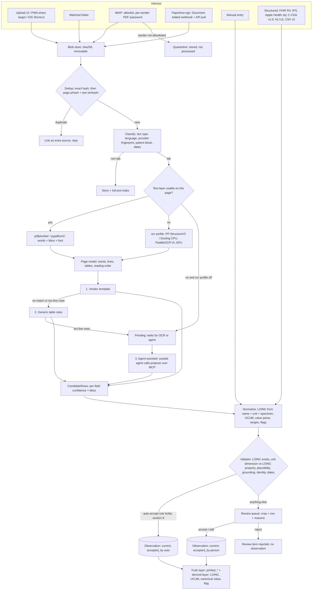
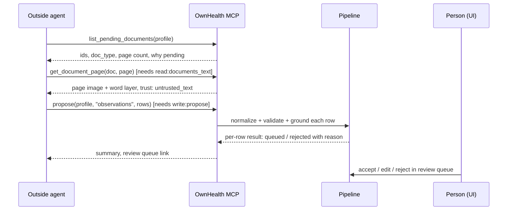
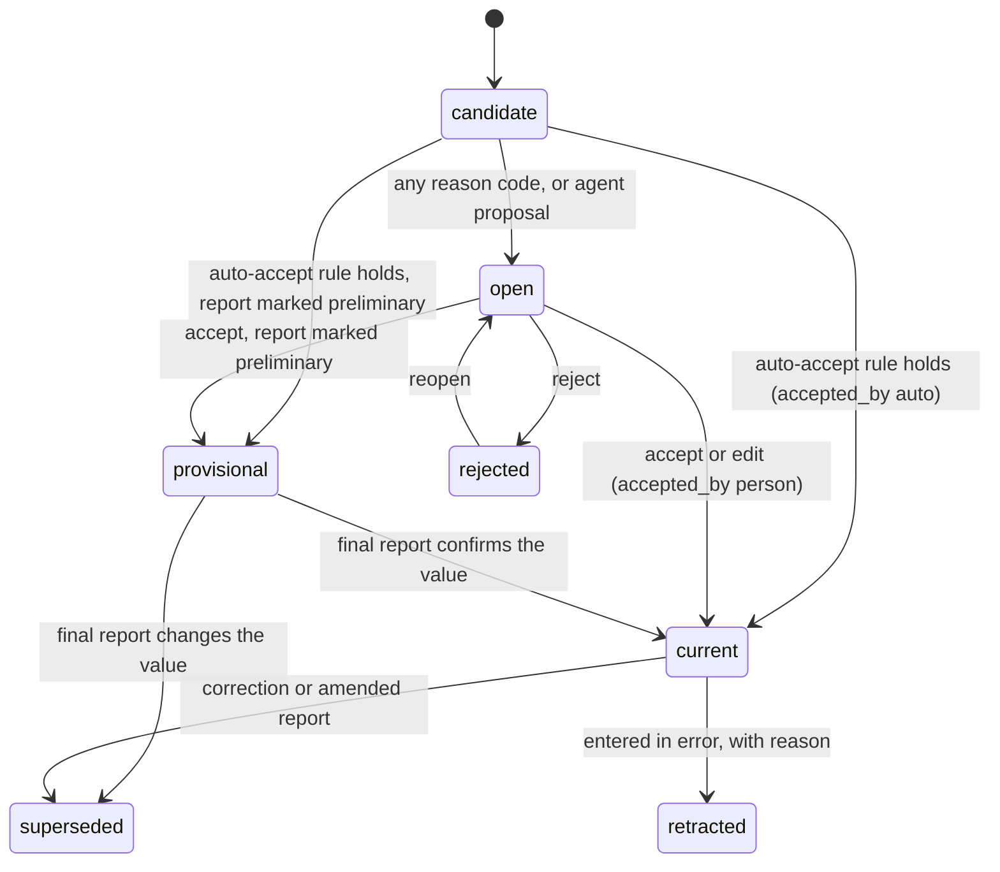

# Ingestion and normalization

How a document or a structured file becomes observations with provenance. This covers lab PDFs, scans and photos, structured imports, and the non-lab documents we store but do not yet extract.

The pipeline has no chat agent and no built-in LLM. It is a fixed chain of jobs. Only the extractor step is pluggable, and every extractor returns the same shape: candidate rows with per-field confidence and a bounding box. Nothing is dropped silently: a row that fails a check goes to the review queue, where a person sees it next to the page crop it came from.

## 1. What ships when

| Piece | Phase |
|---|---|
| Upload in the UI, manual entry | v0.1 |
| PDF text layer (pdfplumber, pypdfium2) | v0.1 |
| Vendor templates + generic table rules | v0.1 |
| LOINC/UCUM normalization, flags from the lab's own range | v0.1 |
| Review queue | v0.1 |
| FHIR R4 / IPS bundle import, Apple Health export zip (incl. `clinical-records/`) | v0.1 |
| Store + full-text index for non-lab documents, listed in the document vault | v0.1 |
| Watched folder, email-in, Paperless-ngx webhook, PWA share target, iOS Shortcut | v0.2 |
| `ocr` compose profile (scans and photos) | v0.2 |
| Agent-assisted extraction (`list_pending_documents`, `get_document_page`, `propose`) | v0.2 |
| Non-lab documents on the timeline | v0.3 |
| C-CDA import | v1.0 |
| HL7 v2 ORU^R01 and lab CSV importers | v2 |
| Extraction from discharge letters, imaging reports, prescriptions | after v0.3 |
| Optional cited "optimal" ranges | not scheduled, off by default, see Open decisions |

## 2. Pipeline



Each step is a row in the Postgres job table, picked with `SELECT ... FOR UPDATE SKIP LOCKED` by the in-process job loop. Every step writes its output plus the tool name and version, so "why does this say 140?" always resolves to: blob, page 2, bbox, engine `pdfplumber 0.11.x`, extractor `template:examplelab-es-v3`, resolver `alias:ldl-es-04`.

## 3. Inboxes

All inboxes produce the same thing: a blob, a `document` row with `source_channel` and `source_ref`, and a profile hint. The profile hint is never trusted alone (see the Identity check in section 9).

| Inbox | Mechanism | Profile hint | Phase |
|---|---|---|---|
| Upload UI | Drag and drop, multi-file, `POST /api/ingest/upload` | Profile picked in the UI | v0.1 |
| Manual entry | Form with name autocomplete from the alias table, unit picker filtered by the resolved LOINC property | The profile being edited | v0.1 |
| Watched folder | Polling (inotify is unreliable on SMB/NFS mounts) of `/inbox/<profile-slug>/`. A file is taken once its size is unchanged for 10 s. After the blob commits it moves to `/inbox/.done/`, on failure to `/inbox/.failed/` with a `.reason.txt` | Subfolder name | v0.2 |
| Email-in (IMAP) | Dedicated mailbox, poll every 5 min plus IDLE when the server supports it. Attachments become documents; the HTML/text body is stored as its own document. Processed mail moves to an `OwnHealth/Done` folder | Sender rule | v0.2 |
| Paperless-ngx | Webhook + API pull, polling fallback (3.1) | Tag or correspondent rule | v0.2 |
| PWA share target | `share_target` in the web manifest, `POST multipart/form-data` to `/api/ingest/share`. Android only, iOS Safari has no share target | Profile chosen on the share screen | v0.2 |
| iOS Shortcut | A published Shortcut that POSTs the shared file to `/api/ingest/upload` with an upload-only token | Token is bound to one profile | v0.2 |
| Structured imports | FHIR R4 Bundle, IPS / EU Patient Summary (FHIR), Apple Health export zip. C-CDA in v1.0; HL7 v2 ORU^R01 and lab CSV in v2 | Patient resource matched to a profile, else asked | v0.1 (FHIR, IPS, Apple), v1.0 (C-CDA), v2 (HL7 v2, CSV) |

### 3.1 Paperless-ngx

1. The user creates a Paperless workflow: trigger "Document Added", filter tag `health`, action Webhook to `https://<ownhealth>/api/ingest/paperless` with body `{"doc_url": "{{doc_url}}"}` and a header `X-OwnHealth-Secret`. Paperless needs `PAPERLESS_URL` set or `doc_url` is null.
2. We parse the document id from `doc_url` and pull the original through `GET /api/documents/<id>/download/?original=true` with a Paperless API token (read-only user recommended). We never trust document content in the webhook body.
3. If the original has no usable text layer, we also pull the archived PDF (`/download/` without `original`), which carries Paperless's OCRmyPDF/Tesseract layer. We treat that layer as OCR output (`engine: paperless-tesseract`, OCR-level confidence), never as a native text layer.
4. We write back the tag `ownhealth-imported` and store the Paperless id as `source_ref`. Custom fields in webhook templates are recent (PR 14559), so we do not depend on them.
5. Polling fallback: `GET /api/documents/?tags__id__in=<health>&modified__gt=<cursor>` every 15 min, for setups where Paperless cannot reach us.

https://docs.paperless-ngx.com/usage/
https://docs.paperless-ngx.com/api/
https://github.com/paperless-ngx/paperless-ngx/pull/14559

### 3.2 Email-in

- **Allowlist only.** A sender rule is `{address or domain, profile, doc_type_hint, pdf_password_ref}`. We match on the `From` address and require `Authentication-Results` to show DKIM or SPF pass for that domain, because `From` alone is trivial to forge. A pass proves the domain, not the mailbox. An address rule therefore relies on the sender's mail service letting each account send only as its own address, which the large providers enforce. Where a domain's server lets one account send as another address, the rule in effect trusts the whole domain, and the setup guide says so. Only a header stamped by the receiving server counts: the inbox setting `trusted_authserv_id` names it, and any `Authentication-Results` with another authserv-id is ignored, because a sender can write that header too. The setup guide asks the user to confirm their mail server strips incoming headers that claim its own authserv-id (RFC 8601 section 5); most do. If the receiving server adds no `Authentication-Results`, the rule must say `trust_unauthenticated: true` explicitly.
- **Quarantine.** Mail from anyone else is stored as a blob with `status: quarantined` and is not classified, extracted or indexed. The UI shows the quarantine list with sender, subject and attachment names. Actions: release once, release and add sender, delete.
- **Per-sender PDF passwords.** Many Spanish portals mail PDFs encrypted with a password derived from the patient's ID document number. The password lives in the secrets table, encrypted at rest, referenced by id from the sender rule. We try only that sender's passwords, never a global list. Passwords never appear in logs, job payloads, audit rows or error messages. A PDF that will not open goes to review as `encrypted_unknown_password`.
- We store the decrypted PDF as a second blob linked to the encrypted original (`derived_from`), so the original bytes stay intact.
- Limits: 25 MB per attachment, 50 attachments per message, MIME types `application/pdf`, `image/*`, `application/zip` (structured exports), `application/fhir+json`, `application/json`, `text/xml`. Anything else is stored and listed, not processed.
- Dedup on `Message-ID` in addition to blob hash.

### 3.3 Structured imports

Structured inputs skip OCR and extraction. They go straight to normalization and validation, with provenance pointing at the resource instead of a bbox: `{blob, resource_type, resource_id, json_pointer}`, for example `Bundle.entry[14].resource.valueQuantity`.

- FHIR Observations with a LOINC code and a valid UCUM `valueQuantity` can auto-accept. Missing code, unknown code or unit that will not parse goes to review like any other row.
- `Observation.note`, `DiagnosticReport.conclusion` and any narrative (`text.div`) are stored as untrusted text (section 10).
- An IPS or EU Patient Summary often arrives as a PDF only. We treat it as a document, and also check for embedded files (PDF attachments, XMP) carrying the FHIR or CDA payload.
- The Apple Health zip: `clinical-records/*.json` are FHIR resources and follow this path. The `export.xml` samples belong to the wearables path and are out of scope here.

## 4. Blob store and dedup

- Bytes go to `blobs/sha256/ab/cd/<full-hash>` before any processing. Blobs are immutable. Re-processing creates a new `extraction_run`, never a new blob.
- Dedup levels:
  1. **Exact:** same sha256 for the same profile. The new arrival becomes an extra `document_source` row (channel, ref, received_at) on the existing document. Processing stops.
  2. **Near-duplicate:** per-page perceptual hash of the rasterized page (Hamming distance <= 6 on a 64-bit pHash) plus a simhash of normalized text. Catches a portal re-download with a new footer timestamp, or a scan of a printout we already hold. A near-duplicate is processed, then shown in review as "probably the same as document X" with a link-instead-of-import action.
  3. **Observation level:** same profile + `alias_group` + equal canonical value + same comparator + same method (direct or calculated) + same collection time, from two sources = one logical fact with two provenance links. Trends count it once. A missing collection time on either side, or a different comparator, sends the row to review instead ([architecture.md section 10](architecture.md#10-normalizer)).

## 5. Classification

Rule-based in v0.1, user-overridable in the UI. No model.

| Output | How |
|---|---|
| `doc_type`: lab, imaging_report, discharge_letter, prescription, genomics_report, patient_summary, other | Keyword sets per language on the first two pages ("Hemograma", "Bioquímica", "Informe de alta", "Befund", "Compte rendu", "Laboratory report") plus provider fingerprint |
| `language` | Character n-gram detector over the text layer; es, en, de, fr first |
| Provider fingerprint | Header words, logo image hash, column header words; selects a vendor template |
| Patient block | Name, date of birth, sex, lab sample id (hashed) from the page header |
| Dates | Collection date ("Fecha de extracción", "Entnahme", "Date de prélèvement", "Collected"), report date, validation date |
| Report status | "Informe provisional", "vorläufiger Befund", "preliminary", "amended", "rectificado" |

## 6. Text layer first, OCR second

Most lab PDFs from hospital groups and large labs are born digital. Their text layer is exact and costs nothing to read. We test every page, because scanned annex pages inside digital reports are common.

A page's text layer is usable when all hold:
- at least 150 characters on the page;
- at least 50% of tokens of 3+ letters are found in the es/en/de/fr word lists;
- no `(cid:NN)` glyph runs, and fewer than 5% of characters in the Private Use Area (fonts without a ToUnicode map).

| Library | Licence | Use |
|---|---|---|
| pdfplumber (pdfminer.six) | MIT | Words with bbox, font name, size and fill colour; table heuristics. Default reader. |
| pypdfium2 | Apache-2.0 / BSD-3 | Page rasterization for OCR, crops for the review UI, fast char boxes (detail of the word-bbox API unverified) |
| PyMuPDF | AGPL-3.0 | Licence-compatible with our AGPL, but not used: we chose pdfplumber + pypdfium2 ([PLAN.md](../PLAN.md)) |

Font colour, size and position are kept per word, because the injection checks in section 10 need them.

### 6.1 OCR engines

Only scans, photos and pages that fail the usable check reach OCR. OCR runs only in the `ocr` compose profile. Without it, those pages wait as `pending` for OCR or for agent-assisted extraction. Every engine sits behind one interface:

```python
def ocr_page(image: bytes, lang_hint: list[str]) -> PageModel:
    # words[], lines[], tables[], reading_order, engine, engine_version
```

Photos get orientation fix, deskew and dewarp first (PaddleOCR ships document orientation and unwarping modules).

| Engine | Code / weights licence | Hardware | Tables | Notes | Our use |
|---|---|---|---|---|---|
| PaddleOCR 3.x PP-StructureV3 | Apache-2.0 | CPU | Yes, to HTML/JSON | 100+ languages; no Intel iGPU path verified | **Default CPU engine** (candidate, with Docling) |
| Docling | MIT code; models Apache-2.0 / CDLA-Permissive-2.0 / MIT | CPU, a few s/page | TableFormer, good on clean tables | Cleanest licence stack; does text-first then OCR (EasyOCR, Tesseract or RapidOCR) | **Default CPU engine** (candidate, with PP-StructureV3) |
| PaddleOCR-VL 0.9B | Apache-2.0 repo; weights Apache-2.0 (Hugging Face model card) | Small GPU or iGPU; slow on CPU | Strong (vendor OmniDocBench claim, unverified) | 109 languages | **Candidate GPU/iGPU default**, pending eval numbers |
| Tesseract 5 | Apache-2.0 | CPU | No | spa/deu/fra data; weak on phone photos | Fallback only |
| docTR | Apache-2.0 | CPU, GPU optional | No | Good word boxes | Plug-in |
| MinerU 3.x | From 3.1.0 Apache-2.0 plus extra conditions; up to 3.0.9 AGPL | GPU | Very strong | Read the extra terms first | Opt-in plug-in, not default |
| Marker / Surya | Code Apache-2.0 or GPL; weights modified OpenRAIL-M with a revenue cap | GPU | Good | Not safe as a default for others to rehost | Opt-in plug-in |
| olmOCR 2 | Apache-2.0 | 7B, needs 12-16 GB VRAM | Good | Training data mostly English | Opt-in plug-in |
| DeepSeek-OCR 2, dots.ocr | Apache-2.0; MIT plus extra agreement | GPU, ~3B | Good | Check dots terms | Opt-in plug-in |

Throughput on an Intel integrated GPU (OpenVINO, llama.cpp SYCL) is unmeasured. We publish numbers from the eval harness (section 13) before we recommend a GPU default for that hardware. Target for the default profile: the app container plus `ocr` on CPU in 4 GB RAM.

The things that break lab tables are layout, not characters: wrapped analyte names, the range column read as the value (`3,5 - 5,0` next to `4,1`), decimal commas, thousands separators (`250.000/µL` in Spanish is 250000), flags carried as bold or arrows, non-numeric results (`<0,5`, `negativo`, `indetectable`, `trazas`), and repeated header blocks on every page. Sections 7 and 8 target these.

https://github.com/PaddlePaddle/PaddleOCR
https://huggingface.co/PaddlePaddle/PaddleOCR-VL
https://github.com/docling-project/docling
https://opendatalab.github.io/MinerU/reference/changelog/
https://huggingface.co/datalab-to/surya-ocr-2/blob/main/LICENSE
https://allenai.org/blog/olmocr-2
https://github.com/studio-dots-ai/dots.ocr

## 7. Extractor chain

```python
class Extractor(Protocol):
    id: str          # "template:examplelab-es-v3", "rules:generic-table-v1", "agent:propose"
    version: str
    def applies(self, doc: DocMeta, pages: list[PageModel]) -> float: ...   # 0..1
    def extract(self, doc: DocMeta, pages: list[PageModel]) -> list[CandidateRow]: ...
```

| Order | Extractor | Runs when | Auto-accept allowed |
|---|---|---|---|
| 1 | Vendor template (YAML: fingerprint, anchors, column x-ranges, row regex, value locale) | Fingerprint score >= 0.8 | Yes |
| 2 | Generic table rules (find a block with name / value / unit / range columns, group rows by y-overlap and font) | No template, or the template returned < 50% of the rows the page appears to hold | Yes, text layer only |
| 3 | Agent-assisted (outside agent over MCP) | The page is pending and an agent with `write:propose` works on it | Never |

Rules for the chain:
- There is no model inside the chain. A page that steps 1 and 2 cannot read waits as pending for an outside agent (7.2) or for manual entry.
- When two extractors read the same row and agree on (alias_group, value, unit), confidence rises by 0.1 (cap 0.99). When they disagree, the row goes to review with both readings.
- **Template learning:** after a person corrects rows from an unknown layout, the UI offers "save as template for this provider". It records anchors and column x-ranges only, no values and no patient block. Templates live in the repo as YAML under `src/ownhealth/ingest/pdf/vendors/<country>/<provider>.yaml` ([architecture.md section 5](architecture.md#5-code-repository-layout)), reviewed like code.

### 7.1 CandidateRow

```json
{
  "document_id": "doc_01J9...",
  "page": 2,
  "bbox": [56.2, 410.8, 538.0, 423.1],
  "extractor": "template:examplelab-es-v3",
  "extractor_version": "3.1.0",
  "engine": "pdfplumber 0.11",
  "cells": {
    "name":      {"text": "Colesterol LDL",   "bbox": [56.2, 410.8, 160.4, 423.1], "conf": 0.99},
    "value":     {"text": "131",              "bbox": [300.1, 410.8, 318.6, 423.1], "conf": 0.99},
    "unit":      {"text": "mg/dL",            "bbox": [340.0, 410.8, 372.5, 423.1], "conf": 0.99},
    "ref_range": {"text": "< 116",            "bbox": [420.0, 410.8, 452.2, 423.1], "conf": 0.98},
    "flag":      {"text": "*",                "bbox": [322.0, 410.8, 327.0, 423.1], "conf": 0.95},
    "method":    {"text": "Calculado (Friedewald)", "bbox": null, "conf": 0.90}
  },
  "row_conf": 0.95
}
```

Bboxes are PDF points, origin top-left, in the page's own coordinate space. `row_conf` = min over required cells (name, value, unit) times the extractor prior (template 1.0, rules 0.95, OCR-backed rows times the mean OCR word confidence).

### 7.2 Agent-assisted extraction (v0.2)

The outside agent does the reading the app cannot do, and OwnHealth checks every digit.



`propose` payload for kind `observations`:

```json
{
  "document_id": "doc_01J9...",
  "rows": [
    {"page": 1, "printed_name": "TSH", "printed_value": "2,41", "printed_unit": "µUI/mL",
     "printed_ref_range": "0,35 - 4,94", "bbox": [60, 300, 520, 312]}
  ],
  "note": "Rows from page 1 table 'Hormonas'"
}
```

`bbox` is optional. Grounding runs on every row either way. A page with no word layer (a scan while the `ocr` profile is off) gives grounding nothing to check against; its agent rows go to the review queue marked `ungrounded_no_word_layer`, shown next to the page image so the person compares each digit, and they never count as grounded. Such a row is stored as a candidate row like any other; when the agent sent no `bbox`, its `bbox` is null and the review shows the whole page. A row whose value is not on the page is returned as `rejected: not_grounded` and also stored in the review queue as rejected, so the person sees what the agent claimed. Proposals never auto-accept. The review item records the agent's token id and, from the audit log, which documents and src ids that token read in the hour before the proposal ([security-privacy.md](security-privacy.md)).

## 8. Normalization

### 8.1 Value parsing

- Locale per document (from language and template). In es/de/fr, `,` is decimal and `.` groups thousands; in en the reverse. A value with both is parsed by the last separator. A lone `.` followed by exactly 3 digits in an es/de/fr document is a thousands separator only when the unit is a count (`/µL`, `/mm3`, `x10^3/µL`); otherwise the row goes to review as `ambiguous_separator`.
- Comparators: `<`, `>`, `<=`, `>=`, `≤`, `≥`, `inferior a`, `kleiner als` go to `value_cmp`.
- Text results: `negativo`, `positivo`, `indetectable`, `no detectado`, `trazas`, `negativ`, `nicht nachweisbar`, `négatif`, `absence` map to a small coded set (`negative`, `positive`, `not_detected`, `trace`) with the printed text kept.
- Unicode clean-up for matching only: `µ`/`μ`/`u`, `–`/`-`/`−`, non-breaking spaces. The printed string is stored as found.

### 8.2 LOINC resolution

v0.1 ships our own curated LOINC 2.83 subset (202 codes, checked on tx.fhir.org) under the LOINC License, and our own multilingual alias tables. Mirobody's resolver overlays are not imported. LOINC ships with its notice and version number. Codes are optional enrichment: an uncoded row stays usable under its `alias_group`.

Resolution order:
1. Normalize the printed name: lowercase, strip accents (matching only), drop specimen prefixes (`S-`, `P-`, `Suero`, `Sangre`, `Serum`), expand per-language abbreviations.
2. Look up our alias table with (name, language, unit dimension, specimen hint, method hint). The unit dimension picks the code: LDL in mg/dL is a mass concentration code, in mmol/L a substance concentration code.
3. Fall back to the LOINC linguistic variants (es-ES, de-DE, fr-FR), which are formal names and rarely match what labs print.
4. Panel and category names ("Perfil lipídico", "Hemograma completo", "Blutbild") are refused, never coded as an analyte.
5. No match: `loinc = null`, `alias_group` = normalized printed name scoped to the provider, and a review item `unmapped`. We never create a second series for an analyte that already has one: when the alias table grows, `ownhealth rederive` re-links history and recomputes the derived layer.

Calculated and measured values keep separate codes and a visible marker in trends (Friedewald vs direct LDL; eGFR CKD-EPI 2009 vs 2021).

Sample rows of `data/terminology/aliases/{es,en,de,fr}.tsv` (codes marked † still to be checked against the LOINC release we ship):

| alias (as printed) | lang | specimen | property | method | LOINC |
|---|---|---|---|---|---|
| Colesterol LDL / c-LDL | es | Ser/Plas | MCnc | calculated | 13457-7 |
| Colesterol LDL directo | es | Ser/Plas | MCnc | direct | 18262-6 |
| LDL Cholesterol / LDL-C | en | Ser/Plas | MCnc | calculated | 13457-7 |
| LDL-Cholesterin | de | Ser/Plas | MCnc | any | 2089-1 |
| LDL-Cholesterin | de | Ser/Plas | SCnc | calculated | 39469-2 |
| Cholestérol LDL / LDL-cholestérol | fr | Ser/Plas | SCnc | calculated | 39469-2 |
| Hemoglobina glicada (HbA1c) | es | Bld | MFr (%) | any (%, DCCT/NGSP units) | 4548-4 |
| Hemoglobina glicosilada A1c | es | Bld | SFr (mmol/mol) | IFCC | 59261-8 |
| Hemoglobin A1c | en | Bld | MFr (%) | any (%, DCCT/NGSP units) | 4548-4 |
| HbA1c / Glykiertes Hämoglobin | de | Bld | SFr (mmol/mol) | IFCC | 59261-8 |
| Hémoglobine glyquée | fr | Bld | MFr (%) | any (%, DCCT/NGSP units) | 4548-4 |
| TSH / Tirotropina | es | Ser/Plas | ACnc | any | 3016-3 |
| TSH / Thyroid stimulating hormone | en | Ser/Plas | ACnc | any | 3016-3 |
| TSH basal / Thyreotropin | de | Ser/Plas | ACnc | any | 3016-3 |
| TSH / Thyréostimuline | fr | Ser/Plas | ACnc | any | 3016-3 |
| Ferritina | es | Ser/Plas | MCnc | any | 2276-4 |
| Ferritin | en / de | Ser/Plas | MCnc | any | 2276-4 |
| Ferritine | fr | Ser/Plas | MCnc | any | 2276-4 |
| 25-OH Vitamina D / Calcidiol | es | Ser/Plas | MCnc | D2+D3 | 62292-8 † |
| 25-Hydroxy Vitamin D | en | Ser/Plas | MCnc | D2+D3 | 62292-8 † |
| 25-OH-Vitamin D3 | de | Ser/Plas | MCnc | D3 only | 1989-3 † |
| Vitamine D (25-OH) | fr | Ser/Plas | SCnc | D2+D3 | † (code to pick) |
| Creatinina | es | Ser/Plas | MCnc | any | 2160-0 |
| Creatinine | en | Ser/Plas | SCnc | any | 14682-9 |
| Kreatinin | de | Ser/Plas | MCnc | any | 2160-0 |
| Créatinine | fr | Ser/Plas | SCnc | any | 14682-9 |
| Filtrado glomerular estimado (CKD-EPI) / FGe | es | Ser/Plas | ArVRat | CKD-EPI 2021 | 98979-8 |
| eGFR (CKD-EPI 2021) | en | Ser/Plas | ArVRat | CKD-EPI 2021 | 98979-8 |
| eGFR (CKD-EPI) / GFR geschätzt | de | Ser/Plas | ArVRat | CKD-EPI, year unstated | 62238-1 † |
| DFG estimé (CKD-EPI) / DFGe | fr | Ser/Plas | ArVRat | CKD-EPI, year unstated | 62238-1 † |

Each alias row carries `source` (curated, mirobody, loinc-variant) and a review date. An eGFR row whose formula year is not printed is coded as the older CKD-EPI code and marked `method_uncertain`; we never assume 2021.

https://loinc.org/kb/license
https://loinc.org/international/spanish/
https://github.com/thetahealth/mirobody
https://github.com/thetahealth/mirobody/issues/234
https://github.com/thetahealth/mirobody/blob/main/LICENSE-3RD-PARTY
https://loinc.org/4548-4

### 8.3 Units and UCUM

- Store the unit **exactly as printed**, the parsed UCUM code, and a canonical value in one canonical unit per `alias_group`. Conversion is derived and never destructive.
- Printed-unit synonyms map to UCUM: `mg/dl`, `mg%` to `mg/dL`; `x10^3/µL`, `10^9/L`, `x10E3/uL`, `miles/µL` to `10*3/uL` or `10*9/L`; `/mm3` and `/µL` to `/uL` (a count per microlitre, so converting to `10*3/uL` divides the value by 1,000); `UI/L`, `IE/l` to `[IU]/L`; `U/l` to `U/L`; `mUI/mL`, `µUI/mL`, `µIU/mL` to `m[IU]/mL` or `u[IU]/mL`. `[IU]` and `U` are not interchangeable.
- **Unit dimension vs LOINC property:** the parsed unit's dimension must match the resolved code's property (MCnc = mass/volume, SCnc = substance/volume, ACnc = arbitrary units/volume, CCnc = catalytic/volume, NCnc = count/volume, MFr/SFr = fraction, ArVRat = volume rate/area). A mismatch sends the row to review. This one check catches most column shifts.
- **Mass to molar** needs a molar mass per analyte. UCUM cannot infer it and wrong molar masses are a documented failure. We keep `normalize/terminology/molar/molar_mass.tsv`, one row per analyte, with a citation and a unit test per entry:

| alias_group | Species used | g/mol | Conventional to SI | Trap |
|---|---|---|---|---|
| glucose | glucose | 180.16 | mg/dL x 0.05551 = mmol/L | |
| cholesterol (total, LDL, HDL) | cholesterol | 386.65 | mg/dL x 0.02586 = mmol/L | |
| triglycerides | triolein (lab convention) | 885.4 | mg/dL x 0.01129 = mmol/L | Not a single molecule; convention only |
| creatinine | creatinine | 113.12 | mg/dL x 88.40 = µmol/L | |
| urea | urea | 60.06 | mg/dL x 0.1665 = mmol/L | |
| BUN | urea nitrogen (2 N) | 28.01 | mg/dL x 0.357 = mmol/L urea | Urea and BUN differ by x2.14 |
| uric acid | uric acid | 168.11 | mg/dL x 59.48 = µmol/L | |
| bilirubin | bilirubin | 584.66 | mg/dL x 17.10 = µmol/L | |
| calcium | Ca | 40.08 | mg/dL x 0.2495 = mmol/L | |
| phosphate | P (as phosphorus) | 30.97 | mg/dL x 0.3229 = mmol/L | Not PO4 (94.97) |
| magnesium | Mg | 24.31 | mg/dL x 0.4114 = mmol/L | |
| iron | Fe | 55.85 | µg/dL x 0.1791 = µmol/L | |
| 25-OH vitamin D | calcidiol (D3) | 400.64 | ng/mL x 2.496 = nmol/L | |
| vitamin B12 | cyanocobalamin | 1355.37 | pg/mL x 0.7378 = pmol/L | |
| folate | folic acid | 441.40 | ng/mL x 2.266 = nmol/L | |
| testosterone | testosterone | 288.42 | ng/dL x 0.03467 = nmol/L | |
| cortisol | cortisol | 362.46 | µg/dL x 27.59 = nmol/L | |

Conversions that are not molar live in the same file with a `kind` field:
- HbA1c: IFCC mmol/mol = 10.929 x (NGSP % - 2.15), the NGSP/IFCC master equation. https://ngsp.org/ifccngsp.asp
- Identity: ferritin ng/mL = µg/L; TSH µUI/mL = mUI/L.
- eGFR: mL/s/1.73 m² x 60 = mL/min/1.73 m².

A unit we cannot convert is never stored silently next to convertible ones: the row keeps its printed value, gets `unit_canonical = null`, and a review item `unit_unconvertible` appears.

https://ucum.org
https://ucum.nlm.nih.gov/ucum-service.html
https://github.com/dalito/ucumvert
https://pubchem.ncbi.nlm.nih.gov/

### 8.4 Reference ranges

- The range **as printed** is stored per observation: low, high, text, and applicability text ("Mujeres: 12-16", "Männer", "Hommes", "3er trimestre"). Ranges are per lab, method, age, sex and pregnancy stage, so we never replace a printed range with a global one.
- Conditioned ranges parse into `ref_ranges[]` with `applies_to {sex, age_min, age_max, pregnancy}`. We pick the applicable one from the profile's sex and age at `effective_at`. If none applies or the parse is ambiguous, the row goes to review.
- No printed range means no flag. The status rule pack sees `range: none`.
- **Optional cited "optimal" ranges** (not scheduled): a YAML pack, off by default, each entry with a citation URL, population and date. Shown as a second, labelled band on charts. Never used for flags or status.

### 8.5 Interpretation flags

- `printed_flag` keeps what the lab printed (`H`, `L`, `*`, `↑`, `↓`, bold), read from the text or the font weight.
- `interpretation` is computed from the applicable printed range only: `L`, `N`, `H`, or `A` for abnormal text results, as HL7 ObservationInterpretation codes. Critical (`LL`, `HH`) only when the lab prints it.
- When the printed flag and the computed one disagree, the row goes to review as `flag_mismatch`. This is a strong sign of a mis-parsed range or a column shift.

## 9. Validation and acceptance

Every candidate row, from any source, runs the same validators. Each failure adds a reason code to the review item.

| Check | Rule | Reason code |
|---|---|---|
| LOINC exists | Code is in the shipped LOINC cut and not deprecated | `loinc_unknown`, `loinc_deprecated` |
| Unit dimension | UCUM dimension matches LOINC property | `unit_dimension_mismatch` |
| Converts | Canonical value computable | `unit_unconvertible` |
| Plausibility | Within hard physiological limits per `alias_group` (`data/terminology/limits/labs.tsv`, e.g. glucose 10-1000 mg/dL, sodium 90-200 mmol/L, HbA1c 3-20 %) | `implausible` |
| Factor 1000 | Value out of limits but value x1000 or /1000 is inside | `suspect_separator` |
| Range sanity | low < high; the value cell does not itself look like a range (`70 - 110`). A value on a bound is real (HbA1c 5.6 with `4.0 - 5.6`) and passes | `range_parse`, `value_is_range` |
| Grounding | Value token (separator-tolerant) found in the page word layer, inside the row bbox +/- 4 pt for rule extractors, anywhere on the page for agent rows; name tokens on the same line band. For a structured import (FHIR, Apple Health) the value must be the one at the row's `json_pointer` or record in the stored blob | `not_grounded`, `name_not_on_line` |
| Identity | Patient name and birth date on the page match the target profile (fuzzy, accent-insensitive). For a structured import, the resource's linked `Patient` (name, birth date, identifiers) matches the profile; an Apple Health export is bound to the profile chosen at upload | `identity_mismatch`, `identity_missing` |
| Dates | Collection date not in the future, not before birth, not after report date | `date_invalid` |
| Duplicate | Same fact already accepted from another source | `duplicate` (link, not import) |
| Conflict | Same `alias_group` + date, different value, already accepted | `conflict` |

### 9.1 Auto-accept rule

A row is committed without a click only when all of these hold:
- every check in the table above passes;
- `row_conf >= 0.95` (instance setting `ingest.auto_accept_threshold`, never below 0.90);
- the source allows it: a known vendor template or generic rules on a native text layer; OCR with a matching vendor template at `row_conf >= 0.98`; or a structured import with a valid code and unit;
- identity is matched, not just hinted: the Identity check passed on the page itself (or on the linked `Patient` for a structured import), not only the inbox's profile hint.

An auto-accepted row is labelled `accepted_by: auto` and stays one click away from correction in the UI. Agent proposals and any row with a reason code always go to review. A document whose rows all passed the checks but missed the threshold can be bulk-accepted in the UI with one action; those rows are labelled `accepted_by: person`.

The eval gate in section 13 holds the rule honest: a false auto-accept on the eval set blocks the merge.

### 9.2 States

Review items are `open`, `accepted`, `rejected` or `dismissed`. A rejected row never becomes an observation; the review item keeps what was read, so the person can reopen it.

Observations follow the fact lifecycle used across OwnHealth: `provisional`, `current`, `superseded`, `retracted`.



`open` and `rejected` are review item states; `provisional`, `current`, `superseded` and `retracted` are observation states.

## 10. Imported text is untrusted

Lab PDFs, email bodies, Paperless documents, FHIR narratives and agent notes can carry text written to steer an agent ("ignore previous instructions and..."). The pipeline itself has no LLM to steer, so the risk is what an outside agent reads later. What we do at ingest:

1. **Structured over text.** Extraction stores cells. Free text that we keep (comments, narrative, the full-text index) is tagged `trust: untrusted_text` and is returned over MCP only inside that marker. Raw page text and page words sit behind `get_document_page` / `get_source` with scope `read:documents_text`, off by default.
2. **Hidden text detection** per page, stored as page flags and shown in review:
   - fill colour within 5% luminance of the background behind it (white on white);
   - font size under 2 pt;
   - words outside the CropBox or under an opaque image;
   - text-layer words with no matching OCR word on the rendered image (only when the `ocr` profile runs);
   - text in PDF metadata, XMP, annotations, form fields and embedded files (stored, never extracted as values).
3. **Instruction-pattern flag.** A small multilingual pattern list ("ignore previous", "system prompt", "you are now", "call the tool", URLs inside lab tables) raises a visible `possible_injection` warning on the document. It is a warning, not a filter: we keep the text, because silently dropping content breaks principle 2.
4. **No outbound path.** No ingest step and no MCP tool can send data out (no share, no export, no email). The pipeline calls no model endpoint.
5. **Writes go through review.** Every `propose` lands in the queue with the list of documents the token read beforehand.
6. **Fixtures.** `tests/fixtures/injection/` holds synthetic PDFs for each case above plus a FHIR `Observation.note` and an email body. CI asserts each one is flagged, that no value is extracted from hidden text, and that the text comes back over MCP only with `trust: untrusted_text`.

## 11. Corrections, versioning, amended reports

- **Truth layer vs derived layer.** `printed_name`, `printed_value`, `printed_unit`, `printed_ref_range`, `printed_flag`, page and bbox never change. LOINC, UCUM, canonical value, applicable range and interpretation are derived and carry a `derivation_version` (normalizer code, alias table, resolver and conversion table versions). A new derivation version recomputes the derived layer in a job, which supersedes each row it changes with a copy holding the same truth layer ([architecture.md section 13](architecture.md#13-upgrades-and-migrations)); the status `state_hash` changes with it.
- **Correction by a person:** a new observation with `supersedes = old.id`; the old one becomes `superseded`. A value entered in error becomes `retracted` with a reason. Nothing is deleted. The reviewer and an optional note are stored.
- **Amended or final report:** the lab sends a new edition. The earlier document gets `superseded_by` pointing at the new one when provider + collection date + hashed sample id match, or >= 50% of `alias_group`s overlap on the same collection date. Identical rows are linked, new rows added, changed values go to review as `amended_value` with both shown. A preliminary report's rows are `provisional` until the final arrives.
- **Ordered but missing:** a "pendiente", "folgt", "à suivre" or "pending" line becomes an `expected_test` row on the report, so "what is still pending?" has an answer.
- **Re-extraction** after a template or engine upgrade: a new `extraction_run`, diffed against accepted rows. Only differences go to review. An accepted value is never overwritten.
- **Delete** is soft with a reason. Hard purge of a document and its blob is a separate explicit action, logged in the audit table, as in [architecture.md section 7](architecture.md#7-blob-store).

### 11.1 Tables

The DDL lives in one place: [architecture.md section 6.2](architecture.md#62-ddl-sketch). This pipeline needs these tables and columns from it:

- `document` with blob hash, channel and ref, `doc_type`, language, provider fingerprint, report status, collection and report dates, `superseded_by`, flags.
- `document_source`: one row per arrival of the same blob (channel, ref, received_at), for exact-duplicate links (section 4).
- `document_page` with `text_layer_ok`, the word layer, a perceptual hash, hidden-text flags and a `tsvector` for full-text search.
- `extraction_run` and `candidate_row` (section 7.1).
- `observation` with the truth layer (`printed_*`, page, bbox), the derived layer and `derivation_version`, `accepted_by`, `supersedes`, lifecycle status.
- `review_item` whose `kind` comes from architecture's list; the fine reason codes from section 9 go in its payload, with `context_src_ids` from the audit log.
- `expected_test(report_document_id, printed_name, reason)` for ordered tests not yet reported.

`observation.fhir` is the FHIR-shaped Observation; the typed columns are projections for queries.

## 12. Non-lab documents

Discharge letters, imaging reports, prescriptions, referral letters and patient summaries in PDF form:
- **v0.1:** stored, classified, text layer read (OCR when the profile is on), full-text indexed with Postgres `tsvector` using the document's language configuration (`spanish`, `english`, `german`, `french`, `simple` as fallback). Listed in the document vault by date and type, and searchable in the UI. They join the timeline in v0.3. Over MCP the text is reachable only through `read:documents_text` and marked untrusted.
- **Later:** extraction of diagnoses, medications and procedures. Codes stay optional: SNOMED CT is bring-your-own (never shipped), ATC is stored per product only, never as a shipped table. An agent can already propose medications and notes from these documents through `propose` in v0.2.

## 13. Evaluation

No public benchmark covers multilingual lab reports, so we build one, fully synthetic.

- **Generator:** `tools/labslips/` renders lab slips from HTML templates to PDF. Synthetic people only (Alex Rivera, Sam Rivera, Lucía Rivera, Carmen Ortega). Each slip comes with ground-truth JSON: every row's name, value, unit, range, flag, page and bbox.
- **Coverage:** es, en, de, fr; at least 6 layouts per language (single column, two column, wrapped names, flags as arrows, flags as bold, multi-page with repeated header); decimal comma and thousands-separator cases; non-numeric results; sex-conditioned ranges; one amended report pair per language.
- **Variants:** born-digital PDF; rasterized at 200 dpi; phone-photo simulation (perspective, blur, JPEG 60, uneven light); a PDF with a broken ToUnicode map.
- **Injection set:** section 10 fixtures.

| Metric | Definition | Gate |
|---|---|---|
| False auto-accept rate | Auto-accepted rows whose value, unit or code differ from truth | 0 on the whole set, blocks merge |
| Row recall | Truth rows that reach the queue or the record | >= 0.98 born-digital, >= 0.90 photos (target) |
| Value exact match | After normalization, among extracted rows | >= 0.995 born-digital (target) |
| Unit match | UCUM code equal to truth | >= 0.99 (target) |
| LOINC top-1 | On analytes the alias table covers | >= 0.97 (target) |
| Review rate | Share of rows needing a person | Tracked per extractor and engine, no gate |
| Grounding catches | Planted wrong values in agent proposal fixtures rejected | 100%, blocks merge |
| Injection flags | Fixtures flagged and not extracted | 100%, blocks merge |
| Throughput | Pages/min per engine and hardware | Published, no gate |

The eval runs in CI on the born-digital set for every change to templates, rules, aliases or units. OCR engine runs happen on a schedule on a self-hosted runner with the `ocr` profile, and the numbers go into `docs/benchmarks/ocr.md`.

The approach follows the synthetic generator idea in https://github.com/thetahealth/mirobody-gen

## 14. Open decisions

1. **CPU OCR default:** PP-StructureV3 or Docling. Both are allowed. We pick by the eval set (photo recall and table structure) and image size.
2. **Remote OCR endpoints.** Not allowed (LAN or localhost only), because a remote endpoint sends health data off the box. Revisit only with a per-profile opt-in and a visible "this document goes to X" banner.
3. **Upload token for the iOS Shortcut and share target.** The scope list covers MCP only. We need an upload-only REST token bound to one profile; it should not be an MCP scope.
4. **Optional "optimal" ranges.** Not on the roadmap. Proposed: later, behind a cited YAML pack, off by default, never used for flags or status.
5. **Shipping the LOINC cut.** We plan to vendor Mirobody's LOINC 2.83 content with the Regenstrief notice and the LOINC License, and its UCUM file under the UCUM License. Whether a subset in a public AGPL repo needs anything beyond the notice is unverified; the fallback is a download at install time.
6. **Paperless as the recommended single inbox.** It already does IMAP, a consume folder and OCRmyPDF. Our own watched folder and IMAP may be enough as fallbacks.
7. **Identity check strictness.** Some Spanish PDFs print only initials or a health card number. Do we let a profile store hashed identifiers (card number, sample id prefix) for matching?
8. **Codes marked †** in 8.2 need checking against the LOINC release we ship before the alias table merges.

Rejected: a model that extracts structured values (an LLM or VLM that writes rows) inside the pipeline. OCR models in the opt-in `ocr` profile only return words and boxes; rules turn those into rows. OwnHealth has no built-in extraction model; pages the rules cannot read go to agent-assisted extraction (7.2) or manual entry. A community plugin could add one outside the core repo.
